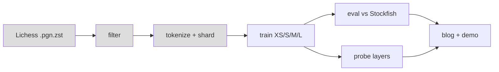

# Chess LM

Small GPT-style models, trained from scratch on Lichess games. We measure their strength against Stockfish. We also probe them for an internal board representation. See `PLAN.md`.

## Status
Infra and tokenizers are done. The data pipeline is next. There are no results yet.


Pipeline. Grey boxes are not built yet. Tokenizers (part of "tokenize") are built.

## Setup (RunPod, A100 80GB)
- Image: `runpod/pytorch:1.0.2-cu1281-torch280-ubuntu2404` (PyTorch 2.8.0).
- Python 3.12.3, python-chess 1.11.2, Stockfish 16 (`/usr/games/stockfish`, `UCI_Elo` minimum 1320).
- Keep the repo and venv in `/workspace`. The container disk is wiped on stop.

```bash
python3 -m venv --system-site-packages /workspace/venv && . /workspace/venv/bin/activate
pip install -e . pytest && pytest -q
```

## Done
- UCI move-token and UCI character tokenizers. 3 round-trip tests pass.

## Next
1. Download and filter one Lichess month. Benchmark PGN-to-UCI games per second per core.
2. Write the shards and the GPT model. Overfit XS on 1k games.
3. Measure real tokens per second and TFLOPs.

## Notes
- Elo is anchored to Stockfish. It is not a Lichess or FIDE rating.
- Data: Lichess open database (CC0).
