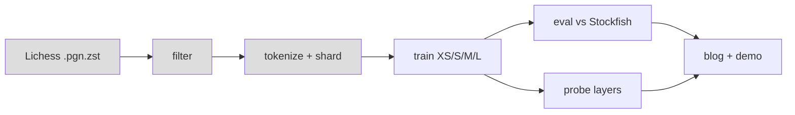

# Chess LM

Small GPT-style models, trained from scratch on Lichess games. We measure their strength against Stockfish. We also probe them for an internal board representation. See `PLAN.md`. Technical choices and learning pointers: `DECISIONS.md`.

## Status
Infra and tokenizers are done. The data pipeline is next. There are no results yet.


Pipeline. Grey boxes are not built yet. Tokenizers (part of "tokenize") are built.

## Setup (RunPod, A100 80GB)
- Image: `runpod/pytorch:1.0.2-cu1281-torch280-ubuntu2404` (PyTorch 2.8.0).
- Python 3.12.3, python-chess 1.11.2, Stockfish 16 (`/usr/games/stockfish`, `UCI_Elo` minimum 1320).
- Keep the repo and venv in `/workspace`. The container disk is wiped on stop.

```bash
python3 -m venv --system-site-packages /workspace/venv && . /workspace/venv/bin/activate
pip install -e . pytest && pytest -q
```

## Done
- UCI move-token and UCI character tokenizers. 3 round-trip tests pass.
- Streaming reader, header filter and PGN-to-UCI replay (`src/chesslm/data/`, `scripts/bench_pgn.py`).
- Fixed move vocabulary: 1,971 tokens (all possible UCI moves plus 3 special tokens). No data pass needed to build it.
- Shard writer `src/chesslm/data/shards.py`. Output is uint16 `tokens.bin` and `offsets.npy` per split.

- GPT model (RoPE), loader and training loop: `model/gpt.py`, `data/dataset.py`, `train.py`. 8 tests pass.
- Parameter counts: XS 5.2M, S 11.4M, M 26.2M, L 50.4M (vocab 1,971).
- Overfit gate passed: XS on 1,000 games reaches 0.094 loss per move. The entropy floor is 0.0927.
- Early speed (XS, 16k-token batch): about 1.3M tokens/s, 40 TFLOPs. Measure again with the real batch size.

## Measurements
Month 2026-09 (29 GB), first 30k games only. Filter: both players 1800+, 3+0 or slower, normal end.

| Item | Value |
|---|---|
| Games kept | 12.0% (early-month slice, may be biased toward bullet) |
| Average length | 72 plies |
| Replay, 1 worker | 475 games/s (34k tokens/s) |
| Replay, 8 workers | 3,509 games/s (253k tokens/s) |
| 1B tokens, 8 workers | about 1.1 hours of replay |
| Stream and filter | about 21k games/s, one process |

## Next
1. Done: shard build for 2026-09 and 2026-08 (both players 1800+). Output: `/workspace/data/lichess_1800` (1.64B train tokens). Raw files deleted.
2. Done: learning-rate sweep on XS (`bash scripts/lr_sweep.sh`). 2e-3 to 6e-3 give equal loss. Choice: 3e-3. See DECISIONS G9.
3. Done: speed test (G10) and L learning-rate check (G11): 3e-3 fails on L. Rule: lr = 3e-3 x 256 / d_model.
4. Next: size sweep XS, S, M, L (same seed, data order). Save extra checkpoints at 0.125B, 0.25B, 0.5B tokens.

## Month-wide count (2026-09)
Full pass over 89.6M games. Tokens are estimated from the last move number. Other filters are as above.

| Both players at least | Games | Tokens |
|---|---|---|
| 1600 | 20.1M | 1.33B |
| 1800 | 11.0M | 0.74B |
| 2000 | 4.2M | 0.29B |

One month at 1800 gives 0.74B tokens, not 1B. Script: `scripts/count_month.py` (about 36 minutes).

## Data download
```bash
python scripts/fetch_month.py 2026-09 /workspace/raw 16   # parallel, resumable, about 13 min
python -m chesslm.data.shards /workspace/data/lichess_1800 24 2026-09 2026-08
```
Check progress: `tail -1 /workspace/shards.log`. Done when it shows `DONE` and `meta.json` exists. Raw files are about 29 GB each.

## New pod checklist
The container disk is wiped on stop. `/workspace` stays.
1. Update `~/.ssh/config` (new IP and port).
2. `apt-get install -y stockfish rsync`
3. `git config --global user.name/user.email` and `credential.helper 'store --file /workspace/.git-credentials'`
4. Install Claude Code and log in. Then run `bash scripts/restore_claude_state.sh` to link memory and history.
5. Before you stop a pod, run `bash scripts/sync_claude_state.sh`.

## Train
```bash
python -m chesslm.train --model xs --name xs_run --data /workspace/data/lichess_1800 --max_tokens 1e9
```
Checkpoints: `/workspace/ckpt/NAME`. The run resumes if you start it again. W&B is offline (`wandb sync` later).

## Notes
- Decision: two months at the 1800 filter. One month gives only 0.74B tokens.
- Split: by CRC32 of the game ID. 98% train, 1% val, 1% test.
- Elo is anchored to Stockfish. It is not a Lichess or FIDE rating.
- Data: Lichess open database (CC0).
