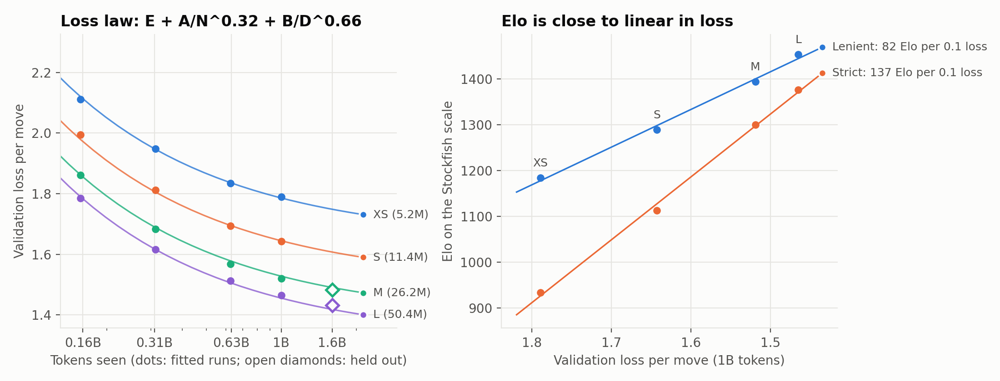

# Chess LM

Small GPT-style models (5M to 50M parameters), trained from scratch on Lichess games. They read moves as text and get no board and no rules.
- **Strength:** Elo against Stockfish rises from 1182 (XS) to 1479 (L). An illegal move loses under the strict rule: 934 to 1376.
- **Scaling:** loss follows E + A/N^0.32 + B/D^0.66. The fit predicts the 1.6B-token runs to within 0.013. Elo is close to linear in loss.
- **Board:** a linear probe reads the board from the hidden states. Balanced accuracy: 0.866 (XS), 0.952 (M), 0.968 (L).
- **Use of the board:** removing the board directions in M hurts 3.7 to 6.7 times more than random directions with the same variance.

| Elo by size | Board by size | Intervention (M) |
|---|---|---|
|  |  |  |


Left: loss against tokens, with the fitted law. Open diamonds are the 1.6B-token runs, which the fit did not see. Right: Elo against loss.

All other figures: `results/figures/`. Make them all with `python scripts/make_figures.py`.

| Where | What |
|---|---|
| `docs/BLOG.md` | Blog post |
| `docs/PROBING.md` | Probing method, results and limits |
| `docs/RUNBOOK.md` | Setup, data steps, step list, new-pod checklist |
| `results/README.md` | Table of all training runs, column meanings |
| `results/EXPERIMENT_LOG.md` | Dated history of every step |
| `DECISIONS.md` | The reason for each choice |

## Play against the models
Weights for all four sizes (1B-token runs): <https://huggingface.co/sinha/chess-lm>. The licence is Apache 2.0.

Each GIF shows the model (white) against Stockfish at 1320 Elo for the first 8 moves.

| XS | S | M | L |
|---|---|---|---|
|  |  |  |  |

To play a model in your browser:
1. Install the code: `pip install -e . safetensors huggingface_hub`.
2. Run `python scripts/play_gui.py --size l`. It downloads the model from Hugging Face.
3. Open `http://127.0.0.1:8000`. Click a piece, then click the square to move to.

To use a local file, run `python scripts/play_gui.py --weights path/model.safetensors` or `--ckpt path/final.pt`.
The model picks its best legal move. Add `--temperature 1` to make it vary. Make new GIFs with `python scripts/make_gifs.py`.

## Train
```bash
pip install -r requirements.txt && pip install -e . --no-deps
python -m chesslm.train --model xs --name xs_run --data /workspace/data/lichess_1800 --max_tokens 1e9
```
Data build and pod setup: `docs/RUNBOOK.md`.

## Notes
- Elo is anchored to Stockfish. It is not a Lichess or FIDE rating.
- Data: Lichess open database, <https://database.lichess.org> (CC0).
- Licence: Apache 2.0 for the code and the weights (`LICENSE`).

## References
- Li et al. 2023, "Emergent World Representations: Exploring a Sequence Model Trained on a Synthetic Task" (Othello-GPT).
- Nanda, Lee and Wattenberg 2023, "Emergent Linear Representations in World Models of Self-Supervised Sequence Models".
- Karvonen 2024, "Emergent World Models and Latent Variable Estimation in Chess-Playing Language Models".
- Toshniwal et al. 2022, "Chess as a Testbed for Language Model State Tracking".
- Hewitt and Liang 2019, "Designing and Interpreting Probes with Control Tasks".
- Stockfish 19 for the opponent and `python-chess` 1.11.2 for the rules. The full reading list for the probes is in `docs/PROBING.md`, section 13.
