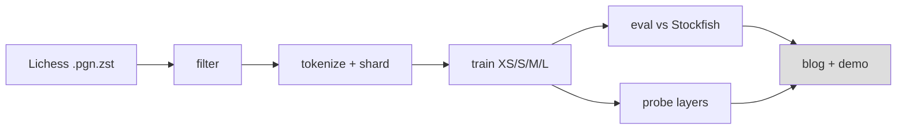
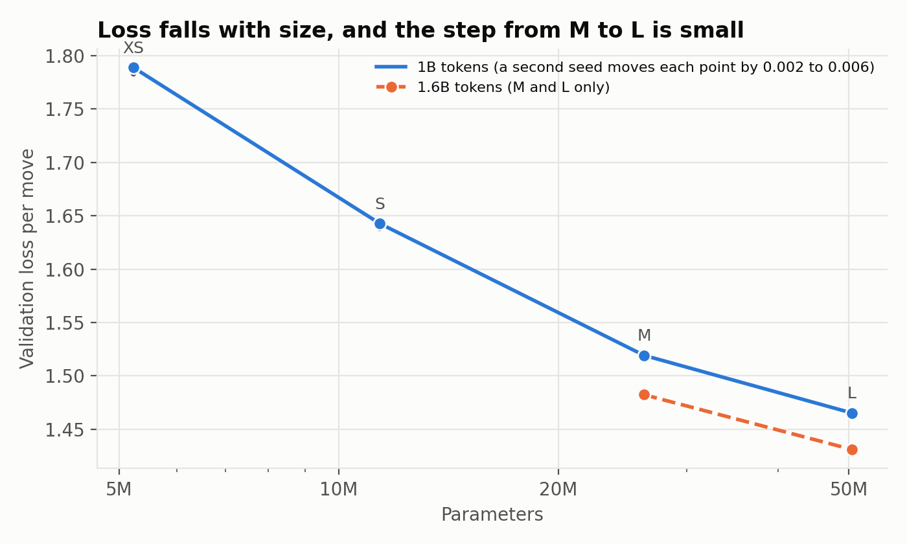
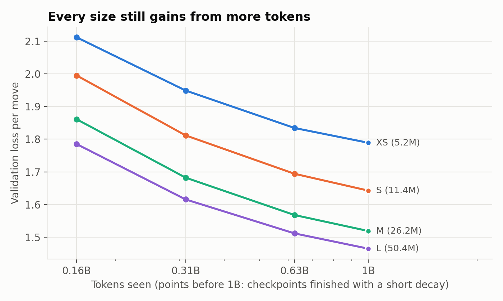
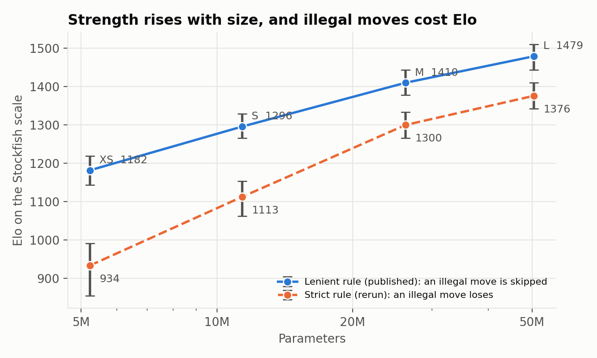
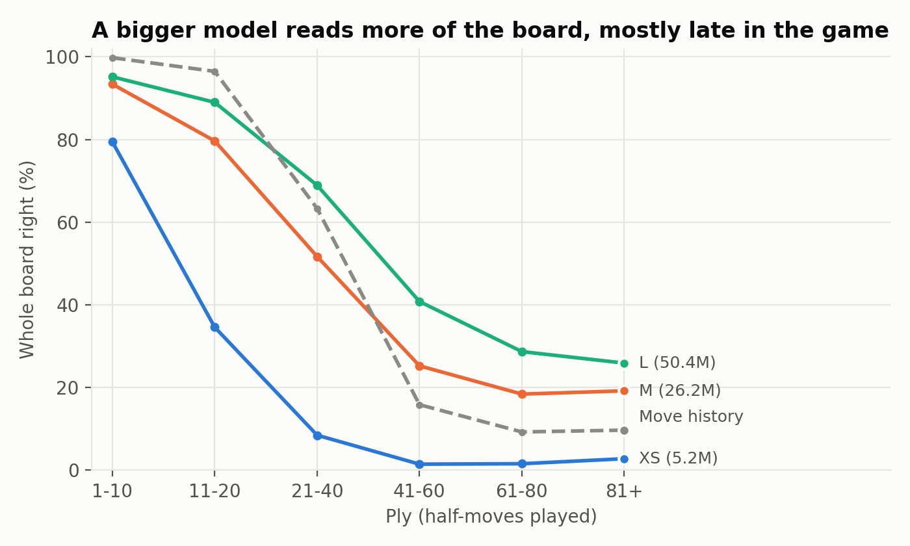
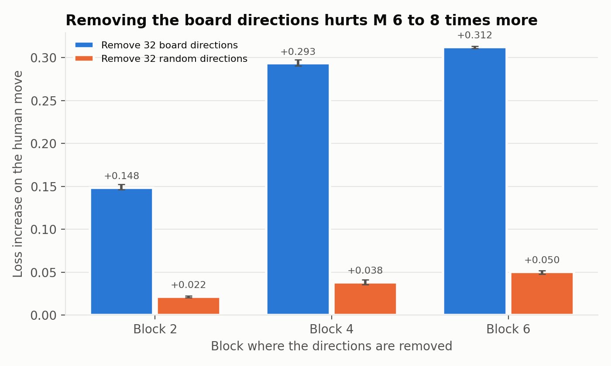
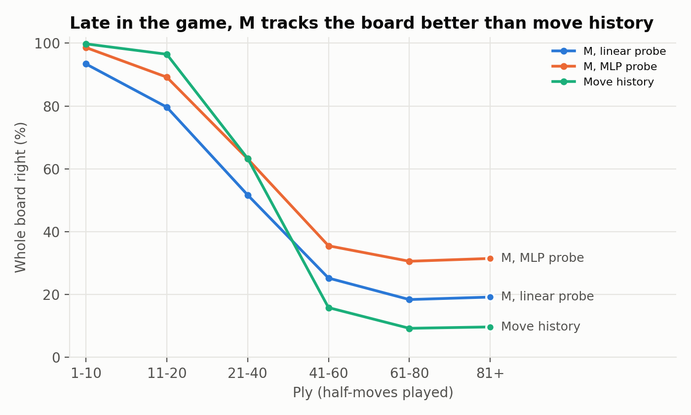
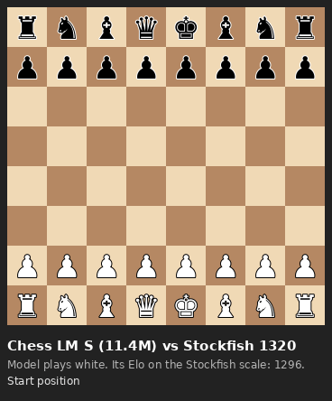
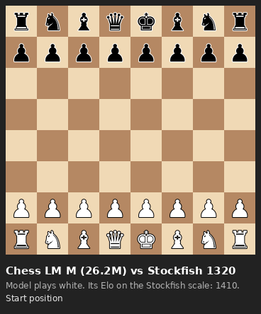
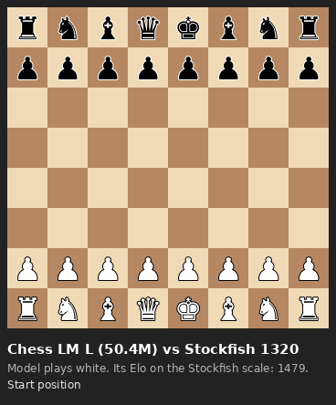

# Chess LM

Small GPT-style models, trained from scratch on Lichess games. We measure their strength against Stockfish. We also probe them for an internal board representation. See `PLAN.md`. Technical choices and learning pointers: `DECISIONS.md`.

## Status
Data is built (1.64B training tokens). The size sweep (XS, S, M, L at 1B tokens) and the seed check for all four sizes are done. The small gain from M to L is real. The token sweep (all four sizes) and the Stockfish evaluation are done. Strength rises with size, and the gain from M to L is smaller. A rate check on L shows the L rate is not the cause of the small step (G22). Probing on M is done: M builds a board representation that a linear probe can read, beats move bookkeeping late in the game, and uses it to choose moves (G23). Probes on XS and L show the board gets better with size (G27). Probe errors by piece type: M is best on queens, rooks and bishops, where move bookkeeping is worst (G25). The L check is done (G24): at 1.6B tokens L reaches 1.431 and M reaches 1.4823. The L lead is 0.051, against 0.054 at 1B. Data is not the cause of the small M-to-L step. Numbers are in the Results section.


Pipeline. Grey boxes are not built yet. Data and training are built.

## Results
All numbers come from the run logs. Do not edit the table by hand. Run `bash scripts/build_results.sh` to rebuild it. Column meanings, curves and configs: `results/README.md`. Step-by-step history: `results/EXPERIMENT_LOG.md`.

<!-- RESULTS:START -->
| Stage | Run | Model | Params | lr | Seed | Tokens | Val loss | Status |
|---|---|---|---|---|---|---|---|---|
| overfit | overfit_xs | xs | 5.2M | 0.0005 | 0 | 0.040B | 0.0939 | done |
| lr_sweep | lr_xs_1e-3 | xs | 5.2M | 0.001 | 0 | 0.100B | 2.4836 | done |
| lr_sweep | lr_xs_2e-3 | xs | 5.2M | 0.002 | 0 | 0.100B | 2.3197 | done |
| lr_sweep | lr_xs_2e-3_s1 | xs | 5.2M | 0.002 | 1 | 0.100B | 2.3432 | done |
| lr_sweep | lr_xs_3e-3 | xs | 5.2M | 0.003 | 0 | 0.100B | 2.3758 | done |
| lr_sweep | lr_xs_3e-3_s1 | xs | 5.2M | 0.003 | 1 | 0.100B | 2.3309 | done |
| lr_sweep | lr_xs_4.5e-3 | xs | 5.2M | 0.0045 | 0 | 0.100B | 2.3399 | done |
| lr_sweep | lr_xs_4.5e-3_s1 | xs | 5.2M | 0.0045 | 1 | 0.100B | 2.3121 | done |
| lr_sweep | lr_xs_6e-3 | xs | 5.2M | 0.006 | 0 | 0.100B | 2.3748 | done |
| lr_sweep | lr_xs_1e-2 | xs | 5.2M | 0.01 | 0 | 0.100B | 3.5064 | done |
| lr_sweep | lr_xs_1.5e-2 | xs | 5.2M | 0.015 | 0 | 0.100B | 3.5973 | done |
| lr_sweep | lr_l_1e-3 | l | 50.4M | 0.001 | 0 | 0.100B | 1.9594 | done |
| lr_sweep | lr_l_2e-3 | l | 50.4M | 0.002 | 0 | 0.100B | 1.945 | done |
| lr_sweep | lr_l_3e-3 | l | 50.4M | 0.003 | 0 | 0.100B | 3.3323 | done |
| speed | speed_s | s | 11.4M | 0.003 | 0 | 0.015B | 5.1307 | done |
| speed | speed_m | m | 26.2M | 0.003 | 0 | 0.015B | 4.9313 | done |
| speed | speed_l | l | 50.4M | 0.003 | 0 | 0.015B | 5.1861 | done |
| size_sweep | size_xs | xs | 5.2M | 0.003 | 0 | 1.000B | 1.789 | done |
| size_sweep | size_s | s | 11.4M | 0.002 | 0 | 1.000B | 1.6427 | done |
| size_sweep | size_m | m | 26.2M | 0.0015 | 0 | 1.000B | 1.5192 | done |
| size_sweep | size_l | l | 50.4M | 0.0012 | 0 | 1.000B | 1.4652 | done |
| seed_check | seed_xs_s1 | xs | 5.2M | 0.003 | 1 | 1.000B | 1.783 | done |
| seed_check | seed_s_s1 | s | 11.4M | 0.002 | 1 | 1.000B | 1.6379 | done |
| seed_check | seed_m_s1 | m | 26.2M | 0.0015 | 1 | 1.000B | 1.5173 | done |
| seed_check | seed_l_s1 | l | 50.4M | 0.0012 | 1 | 1.000B | 1.4622 | done |
| token_sweep | tok_xs_125m | xs | 5.2M | 0.003 | 0 | 0.156B | 2.1114 | done |
| token_sweep | tok_xs_250m | xs | 5.2M | 0.003 | 0 | 0.313B | 1.9488 | done |
| token_sweep | tok_xs_500m | xs | 5.2M | 0.003 | 0 | 0.625B | 1.8342 | done |
| token_sweep | tok_s_125m | s | 11.4M | 0.002 | 0 | 0.156B | 1.9947 | done |
| token_sweep | tok_s_250m | s | 11.4M | 0.002 | 0 | 0.313B | 1.8116 | done |
| token_sweep | tok_s_500m | s | 11.4M | 0.002 | 0 | 0.625B | 1.6942 | done |
| token_sweep | tok_m_125m | m | 26.2M | 0.0015 | 0 | 0.156B | 1.8609 | done |
| token_sweep | tok_m_250m | m | 26.2M | 0.0015 | 0 | 0.313B | 1.6824 | done |
| token_sweep | tok_m_500m | m | 26.2M | 0.0015 | 0 | 0.625B | 1.5681 | done |
| token_sweep | tok_l_125m | l | 50.4M | 0.0012 | 0 | 0.156B | 1.785 | done |
| token_sweep | tok_l_250m | l | 50.4M | 0.0012 | 0 | 0.313B | 1.6158 | done |
| token_sweep | tok_l_500m | l | 50.4M | 0.0012 | 0 | 0.625B | 1.5119 | done |
| rate_check | rate_l_6e-4 | l | 50.4M | 0.0006 | 0 | 1.000B | 1.4734 | done |
| rate_check | rate_l_6e-4_125m | l | 50.4M | 0.0006 | 0 | 0.156B | 1.8766 | done |
| rate_check | rate_l_6e-4_250m | l | 50.4M | 0.0006 | 0 | 0.313B | 1.6636 | done |
| rate_check | rate_l_6e-4_500m | l | 50.4M | 0.0006 | 0 | 0.625B | 1.5319 | done |
| other | full_m | m | 26.2M | 0.0015 | 0 | 1.600B | 1.4823 | done |
| other | full_l | l | 50.4M | 0.0012 | 0 | 1.600B | 1.431 | done |
<!-- RESULTS:END -->

## Figures
All figures come from the CSV files in `results/` with one command: `python scripts/make_figures.py`.

| | |
|---|---|
|  |  |
|  |  |
|  |  |

## Play against the models
Weights for all four sizes (1B-token runs): <https://huggingface.co/sinha/chess-lm>. The licence is Apache 2.0.

Each GIF shows the model (white) against Stockfish at 1320 Elo for the first 8 moves.

| XS | S | M | L |
|---|---|---|---|
|  |  |  |  |

To play a model in your browser:
1. Install the code: `pip install -e . safetensors huggingface_hub`.
2. Run `python scripts/play_gui.py --size l`. It downloads the model from Hugging Face.
3. Open `http://127.0.0.1:8000`. Click a piece, then click the square to move to.

To use a local file, run `python scripts/play_gui.py --weights path/model.safetensors` or `--ckpt path/final.pt`.
The model picks its best legal move. Add `--temperature 1` to make it vary. Make new GIFs with `python scripts/make_gifs.py`.

## Setup (RunPod, A100 80GB)
- Image: `runpod/pytorch:1.0.2-cu1281-torch280-ubuntu2404` (PyTorch 2.8.0).
- Python 3.12.3, python-chess 1.11.2, Stockfish 19 (`/workspace/bin/stockfish`, `UCI_Elo` minimum 1320).
- Keep the repo and venv in `/workspace`. The container disk is wiped on stop.

```bash
python3 -m venv --system-site-packages /workspace/venv && . /workspace/venv/bin/activate
pip install -e . pytest && pytest -q
```

## Done
- UCI move-token and UCI character tokenizers. 3 round-trip tests pass.
- Streaming reader, header filter and PGN-to-UCI replay (`src/chesslm/data/`, `scripts/bench_pgn.py`).
- Fixed move vocabulary: 1,971 tokens (all possible UCI moves plus 3 special tokens). No data pass needed to build it.
- Shard writer `src/chesslm/data/shards.py`. Output is uint16 `tokens.bin` and `offsets.npy` per split.

- GPT model (RoPE), loader and training loop: `model/gpt.py`, `data/dataset.py`, `train.py`. 8 tests pass.
- Parameter counts: XS 5.2M, S 11.4M, M 26.2M, L 50.4M (vocab 1,971).
- Overfit gate passed: XS on 1,000 games reaches 0.094 loss per move. The entropy floor is 0.0927.
- Speed and memory per size: `results/EXPERIMENT_LOG.md`.
- Evaluation harness against Stockfish: `src/chesslm/eval/play.py`.
- Probe code (probes per layer, 5 controls, intervention): `src/chesslm/probe/`. 4 tests pass.

## Measurements
Month 2026-09 (29 GB), first 30k games only. Filter: both players 1800+, 3+0 or slower, normal end.

| Item | Value |
|---|---|
| Games kept | 12.0% (early-month slice, may be biased toward bullet) |
| Average length | 72 plies |
| Replay, 1 worker | 475 games/s (34k tokens/s) |
| Replay, 8 workers | 3,509 games/s (253k tokens/s) |
| 1B tokens, 8 workers | about 1.1 hours of replay |
| Stream and filter | about 21k games/s, one process |

## Next
1. Done: shard build for 2026-09 and 2026-08 (both players 1800+). Output: `/workspace/data/lichess_1800` (1.64B train tokens). Raw files deleted.
2. Done: learning-rate sweep on XS (`bash scripts/lr_sweep.sh`). 2e-3 to 6e-3 give equal loss. Choice: 3e-3. See DECISIONS G9.
3. Done: speed test (G10) and L learning-rate check (G11): 3e-3 fails on L. Rule: lr = 3e-3 x 256 / d_model.
4. Done: size sweep XS, S, M, L at 1B tokens. Final loss per move 1.789, 1.643, 1.519, 1.465 (G13).
5. Done: seed check for M and L (G15). The seed spread is about 0.003, so the small step from M to L is real.
6. Done: token sweep on L and M (G16, G17). Both still gain at 1B tokens. L gains slightly less than M.
7. Done: token sweep for S and XS (G18). The small step from M to L is there at every budget.
8. Done: evaluation against Stockfish (G14, G19). Elo on the nominal scale: XS 1182, S 1296, M 1410, L 1479. Strict rule (an illegal move loses, G28): about 934, 1113, 1300, 1376.
9. Done: rate check on L at 6e-4 (G20, G22). 1.2e-3 is at or near the best rate at 1B tokens. The small M-to-L step has no known cause.
10. Done: probing on M with all 5 controls and the intervention (G21, G23).
11. Done: L check (G24). L 1.431 and M 1.4823 at 1.6B tokens. The L lead is 0.051 (1B: 0.054), so data is not the cause.
12. GPU queue after the L check, in this order:
    1. Done: seeds for XS and S at 1B tokens (G15). Spread 0.006 (XS) and 0.0048 (S).
    2. Done: intervention on M with variance-matched random directions (G26). The board directions hurt 3.7 to 6.7 times more.
    3. Done: probe L and XS at 1B tokens, with all 5 controls (G27). The board gets better with size: 0.866, 0.952, 0.968.
    4. Dropped: a second L seed at 1.6B tokens. The L check shows the step does not grow with data.
13. CPU work during the GPU runs: probing write-up, `docs/PROBING.md`. It teaches the method to a new reader, then gives the results and their limits.
    1. Start: the concepts (linear and MLP probe, directions, SVD, removal, random control).
    2. Done: probe errors by piece type (G25), also for L and XS (G27).
    3. Done: 4 probe figures in `results/figures/` from `python scripts/make_figures.py`. Done: example boards (`results/figures/example_boards.png`). Done: board by size (`results/figures/board_by_size.png`).
    4. Done: the whole of `docs/PROBING.md`, including the worked example (section 3.1) and board by size (section 9). Left: a read-through for consistency.
    5. Proposed: `docs/TRAINING.md`, a teaching doc for scaling, the schedule, rates, seeds and Elo.
14. Project write-up: all figures from one command, blog post (scaling with the L check, strength, probing), credibility checklist gaps (strict and lenient illegal-move results, CC0 licence and citations, the reason to skip the tokenizer ablation). Optional: illegal-move error analysis, demo.
15. Close out: fresh-clone test, final commit and push, `scripts/sync_claude_state.sh`.
16. Later, not in this project: tokenizer ablation, the M rate at short budgets (G22).

## Month-wide count (2026-09)
Full pass over 89.6M games. Tokens are estimated from the last move number. Other filters are as above.

| Both players at least | Games | Tokens |
|---|---|---|
| 1600 | 20.1M | 1.33B |
| 1800 | 11.0M | 0.74B |
| 2000 | 4.2M | 0.29B |

One month at 1800 gives 0.74B tokens, not 1B. Script: `scripts/count_month.py` (about 36 minutes).

## Data download
```bash
python scripts/fetch_month.py 2026-09 /workspace/raw 16   # parallel, resumable, about 13 min
python -m chesslm.data.shards /workspace/data/lichess_1800 24 2026-09 2026-08
```
Check progress: `tail -1 /workspace/shards.log`. Done when it shows `DONE` and `meta.json` exists. Raw files are about 29 GB each.

## New pod checklist
The container disk is wiped on stop. `/workspace` stays.
1. Update `~/.ssh/config` (new IP and port).
2. `apt-get install -y stockfish rsync`
3. `git config --global user.name/user.email` and `credential.helper 'store --file /workspace/.git-credentials'`
4. Install Claude Code and log in. Then run `bash scripts/restore_claude_state.sh` to link memory and history.
5. Before you stop a pod, run `bash scripts/sync_claude_state.sh`.

## Train
```bash
python -m chesslm.train --model xs --name xs_run --data /workspace/data/lichess_1800 --max_tokens 1e9
```
Checkpoints: `/workspace/ckpt/NAME`. The run resumes if you start it again. W&B is offline (`wandb sync` later).

## Notes
- Decision: two months at the 1800 filter. One month gives only 0.74B tokens.
- Split: by CRC32 of the game ID. 98% train, 1% val, 1% test.
- Elo is anchored to Stockfish. It is not a Lichess or FIDE rating.
- Data: Lichess open database, <https://database.lichess.org> (CC0).
- Blog post: `docs/BLOG.md`.
- Tokenizer: the move token only. The tokenizer ablation is skipped for this project (DECISIONS A6).
- Licence: Apache 2.0 for the code and the weights (`LICENSE`).

## References
- Li et al. 2023, "Emergent World Representations: Exploring a Sequence Model Trained on a Synthetic Task" (Othello-GPT).
- Nanda, Lee and Wattenberg 2023, "Emergent Linear Representations in World Models of Self-Supervised Sequence Models".
- Karvonen 2024, "Emergent World Models and Latent Variable Estimation in Chess-Playing Language Models".
- Toshniwal et al. 2022, "Chess as a Testbed for Language Model State Tracking".
- Hewitt and Liang 2019, "Designing and Interpreting Probes with Control Tasks".
- Stockfish 19 for the opponent and `python-chess` 1.11.2 for the rules. The full reading list for the probes is in `docs/PROBING.md`, section 13.

