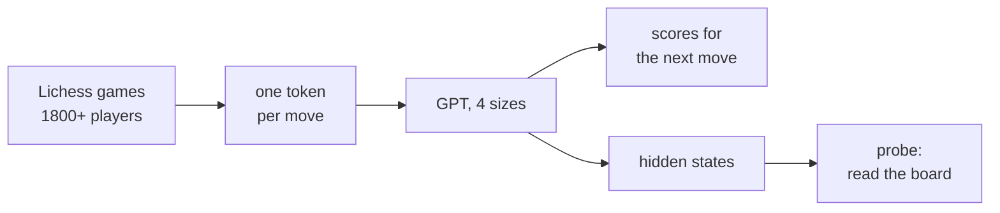
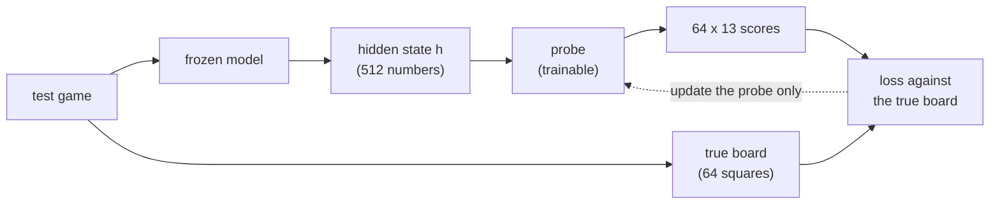
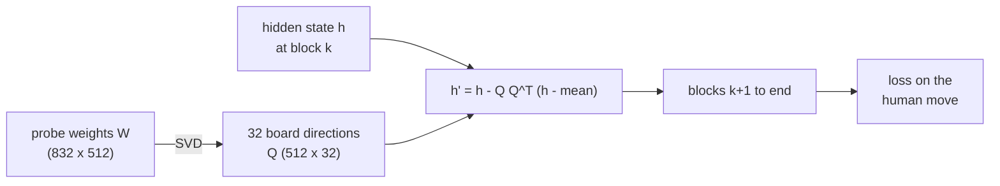

# Small GPTs that learn chess from move lists

We trained four small GPT models on chess games. They read the moves of a game and predict the next move.
They get no board and no rules. This post covers three questions:

1. How does the model improve with size?
2. How well does it play?
3. Does it build a picture of the board inside?

Code, logs and weights: <https://github.com/AshishSinha5/chess-lm> and <https://huggingface.co/sinha/chess-lm>.


## What we built


The pipeline. The top path is the player. The bottom path is how we look inside.

- **Data.** Games from the Lichess open database (CC0), months 2026-08 and 2026-09. Both players are rated 1800 or more. We use 22.4M training games, 1.64B tokens.
- **Tokens.** One token per move in UCI form, such as `e2e4`. The vocabulary has 1,971 tokens.
- **Models.** A plain decoder-only transformer. Each run reads 1B tokens, one pass, with no repeated game.

| Model | Parameters | Layers | Width |
|---|---|---|---|
| XS | 5.2M | 6 | 256 |
| S | 11.4M | 6 | 384 |
| M | 26.2M | 8 | 512 |
| L | 50.4M | 10 | 640 |

We train only on human moves. The model learns to predict what a strong amateur plays, not what is best.

## 1. Loss falls with size, and the last step is small


The loss is the cross-entropy per move on games the model never saw. Lower is better.

| Model | Loss per move | Step from the model before |
|---|---|---|
| XS | 1.789 | |
| S | 1.643 | 0.146 |
| M | 1.519 | 0.124 |
| L | 1.465 | 0.054 |

The step from M to L is less than half of the steps before it. A second seed moves each loss by 0.002 to 0.006, so the small step is real.

We looked for the cause and found two answers that are wrong.

- **Not the learning rate.** We trained L again at half the rate. The loss at 1B tokens changed by only 0.008.
- **Not too little data.** L may need more data than M. If so, a longer run should widen its lead. We trained both on all 1.6B tokens.

| | 1B tokens | 1.6B tokens |
|---|---|---|
| M | 1.519 | 1.482 |
| L | 1.465 | 1.431 |
| L lead over M | 0.054 | 0.051 |

The lead did not grow. The token sweep agrees: every size still gains from more tokens, but L gains slightly less than M.


**Our best guess, not tested.** The data are human moves. Strong players pick between several good moves at random.
No model can remove that part of the loss. The loss steps and the Elo steps both flatten near L, which fits a noise floor.
A second, less likely cause is the shape of L (depth against width). We did not test either cause.

## 2. Strength against Stockfish

We played each model against Stockfish 19 with its `UCI_Elo` limit set to 1320 and 1500. Stockfish gets 0.05 seconds per move.
The first 6 plies (half-moves) come from real games. The models play both colours. Each model plays 400 games.

The models do not know the rules, so they sometimes name an illegal move. We score the games two ways.

- **Lenient rule.** The program skips an illegal top move and plays the model's best legal move.
- **Strict rule.** A game with one illegal top move counts as a loss for the model.


| Model | Top move legal | Elo, lenient | Elo, strict | Games with an illegal move |
|---|---|---|---|---|
| XS | 98.4% | 1182 | 934 | 333 of 400 |
| S | 99.4% | 1296 | 1113 | 273 of 400 |
| M | 99.6% | 1410 | 1300 | 176 of 400 |
| L | 99.5% | 1479 | 1376 | 149 of 400 |

- A small error rate adds up over a game. Even L makes at least one illegal top move in 37% of games.
- The legal-move filter is worth 78 Elo for L and 250 Elo for XS.
- The strict numbers come from a rerun of the games, and Stockfish is not seeded. The lenient rerun agrees with the first run within its 95% interval.

**Read the Elo with care.** It sits on Stockfish's nominal scale, and Stockfish at 0.05 seconds plays below its nominal level.
It is not a Lichess or FIDE rating. Use it to compare our models with each other.

The GIFs at the end of the post show each model in a short game.

## 3. Is there a board inside?

The model never sees a board. It sees a list of moves. To play well, it may keep track of where the pieces are.
We test this with a **probe**. A probe is a small model that reads the hidden state of the network at one point.
Here it tries to name the piece on each of the 64 squares. We train it on one set of games and score it on other games.

### How a probe is trained


The model is frozen. Only the probe learns.

1. **Data.** We take 20k games the model never trained on. From each game we pick up to 5 random positions, about 100k in all.
   For a position after k moves, we run the model on the first k moves and save the hidden state `h` at one layer.
   We also use python-chess to build the true board. Each of the 64 squares has 13 classes: empty, or 6 piece types in 2 colours.
2. **Probe.** The linear probe is one weight matrix `W` of size 832 x 512, plus a bias.
   It turns `h` into 64 x 13 = 832 scores. For each square, the highest of its 13 scores is the predicted piece.
3. **Training.** The loss is the cross-entropy between the 13 scores of each square and the true class, averaged over the 64 squares.
   We use AdamW (learning rate 0.01, cosine decay) on batches of 1,024 positions, for 20 passes or at least 3,000 steps. Only `W` changes. The model never changes.
4. **No leaks.** 80% of the games train the probe. The other 20% score it. No game is in both parts.
5. **One probe for each layer.** We repeat the steps for the output of each block, so we can see where the board appears.

We report **balanced accuracy**: the recall of each of the 12 piece classes, averaged. Empty squares do not count.
Plain accuracy would look good for a probe that says "empty" everywhere, because most squares are empty.

A probe can mislead. It may learn the board by itself, and the network may have no board at all. So we run controls:

- a probe on a model with random weights;
- a probe trained on shuffled board labels;
- a probe that sees only the move list, with no network (**move history**).

**How the move-history control works.** It is the strongest control. It is a probe with the same training as above, but it reads hand-made features instead of a hidden state.
The features come from the move list alone. They use no chess rules and no board simulation.
For each of the 64 squares, we record:

- **The last event on the square.** There are 4 cases: no move ever touched it, a piece left it, a white piece arrived, or a black piece arrived.
- **The from-square of the last move that arrived there.** Because the piece type is not in a UCI move, this tells the probe which piece probably moved. It can look up what stood on that from-square earlier.
- **Whose turn it is.**

Example: after `e2e4`, square e2 is "vacated" and e4 is "white arrived, from e2". A linear probe can learn that "white arrived from e2" often means a pawn.
This control cannot handle captures well, castling or a long chain of moves, because it never updates a board. So it is a fair test of "can simple bookkeeping explain the result?"


One test game. The top row is the true board. The bottom row is what the probe on M reads. Orange marks a wrong square.

### The board is there

For M, the best linear probe reads 98.5% of squares right. It gets the whole board right in 53.8% of positions.
The controls stay far below this. The shuffled-label probe scores about 0.16 in balanced accuracy, against 0.95 for the real probe.
Most of our results use a plain linear probe. A linear probe finds the board only if the network keeps it in an easy form.

### Linear probe or MLP probe

```
linear:  h (512) --[ W: 512 x 832 ]--> 832 scores
MLP:     h (512) --[ 512 x 1024 ]--> 1024 numbers --[ GELU ]--[ 1024 x 832 ]--> 832 scores
```
Both probes read the same hidden state and give the same 832 scores. The MLP adds one hidden layer with a non-linear step.

A linear score is a weighted sum of the 512 numbers, so it finds only information that lies along fixed directions.
An MLP can combine numbers ("this AND that, but NOT the other"), so it can find a board that the network stores in a more complex form.
We use the linear probe as the main tool because it is weak. A weak probe cannot compute the board by itself, so if it reads the board, the network laid the board out clearly.
The gap between the two probes shows how the network stores the board.

Balanced accuracy at the best layer (whole board right in brackets):

| | XS (layer 6) | M (layer 8) | L (layer 9) |
|---|---|---|---|
| Linear probe | 0.866 (23.6%) | 0.952 (53.8%) | 0.968 (65.1%) |
| MLP probe | 0.929 (46.7%) | 0.963 (63.7%) | 0.973 (71.6%) |
| MLP gain | +0.063 | +0.011 | +0.005 |

- In M and L, the MLP adds little. The board is mostly stored in a plain linear form.
- In XS, the MLP adds more. XS has some board information that is not laid out along simple directions.
- In the early layers of M (blocks 1 to 3), the linear probe is as good as or better than the MLP. The MLP gains only from block 5 on.
- The MLP is the stronger probe. Its score shows how much board information the layer holds. The linear score shows how easy that information is to read.

### The model uses it

A probe shows that the information is there. It does not show that the model uses it.
So we remove the board from the hidden state, let M continue, and measure the loss.


The intervention. A hook changes the output of block k. The weights of M do not change.

**Find the board directions.**
The hidden state `h` is a point in a space with 512 dimensions. A *direction* is a unit-length arrow `q` in this space.
The value of `h` along `q` is the number `qᵀh`.
The SVD splits the probe matrix as `W = U · S · Vᵀ`. The rows of `Vᵀ` are orthonormal directions `v1, v2, ...`. The values `s1 ≥ s2 ≥ ...` in `S` rank them.
The probe scores are `W h = U · S · (Vᵀ h)`. A direction with a large `s` changes the scores the most.
We take the first 32 rows of `Vᵀ` as the board directions. They are the columns of `Q`, and `QᵀQ = I`.

**Remove them.**
Let `μ` be the mean hidden state at block k. We replace `h` with:

```
h' = h − Q Qᵀ (h − μ)
```

- `Qᵀ(h − μ)` has 32 numbers. Each one shows how far `h` is from the mean along a board direction.
- `Q Qᵀ(h − μ)` is the part of `h − μ` inside the 32 directions. We subtract it.
- The result has `Qᵀh' = Qᵀμ`. Each board direction now has its mean value. The other 480 directions stay the same.

We use the mean, not zero. Zero is an unusual value for the hidden state. The next block could react to that value and not to the lost information.

We apply this at blocks 2, 4 and 6, with 3 seeds each.


**Control 1: random directions.**
Removing any 32 of 512 directions loses some information, so the loss always rises a little.
We remove 32 random orthonormal directions with the same formula. The board directions hurt far more.

**Control 2: random directions with the same variance.**
The hidden state does not spread equally in all directions. The *variance* along `q` is `qᵀCq`, where `C` is the covariance matrix of the hidden states.
The board directions carry 8% to 10% of the total variance. Plain random directions carry 6.4%.
Removing a high-variance direction moves `h` further from its normal range. The later blocks may react to that move.
So the board directions could hurt more because of their variance, and not because of the board.

To test this, we draw random directions with the same total variance as the board directions:

1. Draw a random matrix `Z` (512 x 32). Compute `Q_t = orth(C^(t/2) Z)`. The `orth` step makes the columns orthonormal.
2. The factor `C^(t/2)` stretches `Z` along the high-variance directions. At `t = 0` the directions are plain random. A larger `t` gives more variance.
3. Search `t` by bisection until `Σ qᵀCq` over the 32 directions equals the value for the board directions.

These directions have no link to the board and as much variance as the board directions.
If variance caused the damage, they would hurt as much. They do not.

| Block | Board directions | Random, same variance | Random |
|---|---|---|---|
| 2 | +0.149 | +0.040 | +0.022 |
| 4 | +0.293 | +0.044 | +0.038 |
| 6 | +0.312 | +0.063 | +0.050 |

Loss increase after removal. The board directions hurt 3.7 to 6.7 times more than the same-variance directions. M uses the board to choose its moves.

This control works at 32 directions only. At 128 directions, plain random directions already carry more variance than the board directions, so there is nothing to match.

### Later in the game, the board beats bookkeeping

Early in a game, the move-history control does very well. It can follow a few moves by itself.
It has no board rules, so it loses track in long games, and M's probe does better.
We count in plies, where one ply is one half-move. M beats the control from ply 41 on.

### A bigger model builds a better board


| | XS | M | L |
|---|---|---|---|
| Linear probe, balanced accuracy | 0.866 | 0.952 | 0.968 |
| Whole board right | 23.6% | 53.8% | 65.1% |
| Beats move history from | never | ply 41 | ply 21 |

XS never beats the bookkeeping control. L beats it from ply 21. Queens are the hardest piece at every size.
L has a clearly better board than M, yet its loss is only 0.054 lower. We do not know why.

## Surprises and failures

- **A false alarm.** A first test with 300 games showed a random-weight model close to the trained one. The full run with 20k games did not.
  The small test had too few positions, and the probe did not train long enough. A probe needs enough data before its result means anything.
- **White and black, not mine and theirs.** In Othello-GPT, the board is stored as "my pieces and their pieces". M stores white and black.
  The white/black target scores 0.952. The player-relative target scores 0.933.
- **The most common probe error is the wrong colour.** The probe often finds the right piece type and gets its colour wrong.
- **The small step from M to L has no known cause.** We ruled out two causes and wrote a guess for the rest.

## Limits

- One seed for each model. Seed 1 is only for the loss at 1B tokens, not for the probes or the games.
- S was not probed. The intervention ran on M only, so "L uses its board" is not tested.
- The Elo uses Stockfish at 0.05 seconds, with 400 games per model. It is not a human rating.
- The models read only the move list. They do not search, so they play weak chess by engine standards.
- The noise-floor cause for the small M-to-L step is a guess.

## Try it

Each GIF shows a model as white against Stockfish at 1320, for the first 8 moves.

| XS | S | M | L |
|---|---|---|---|
|  |  |  |  |

To play a model yourself:

1. Clone the repo and run `pip install -e . safetensors huggingface_hub`.
2. Run `python scripts/play_gui.py --size l`. The script downloads the weights from Hugging Face.
3. Open `http://127.0.0.1:8000` and click to move.

The weights are in `sinha/chess-lm` (Apache 2.0), one folder for each size.

## Where to read more

Everything here is logged. `DECISIONS.md` has each choice and its result (G13 to G28).
`docs/PROBING.md` teaches the probing method from the start, with the reading list.
`results/EXPERIMENT_LOG.md` has every command and number.
