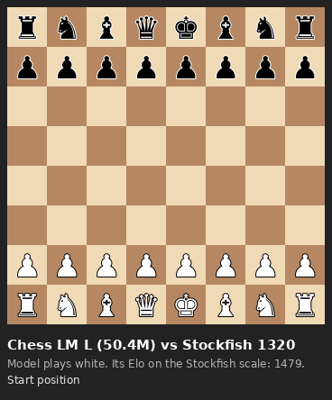
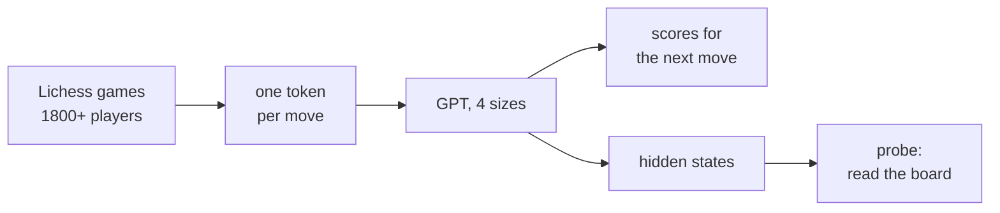
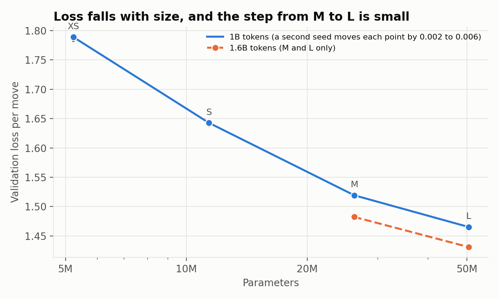
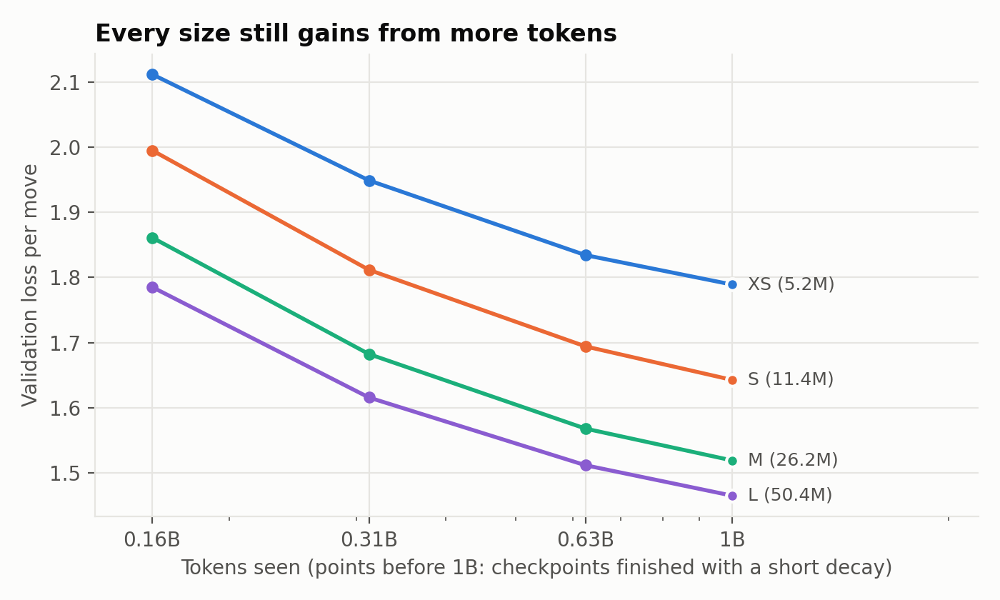
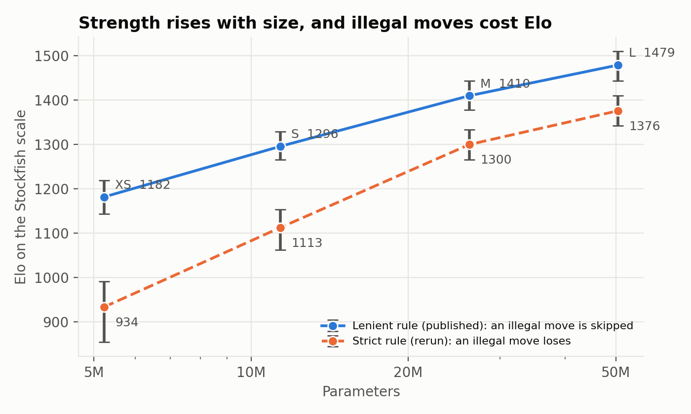
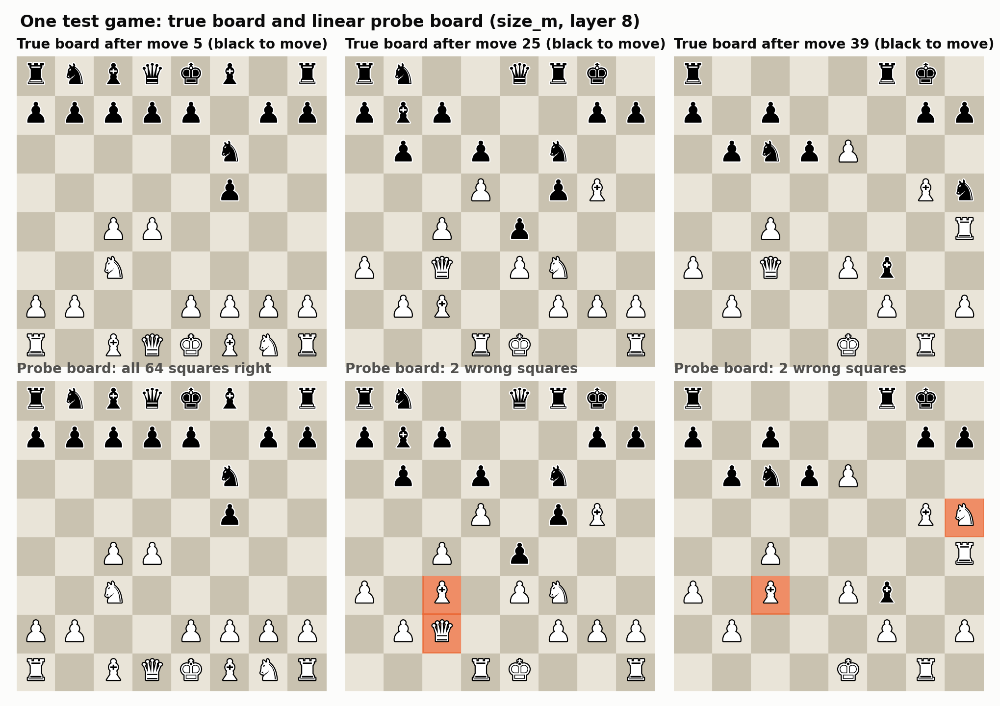
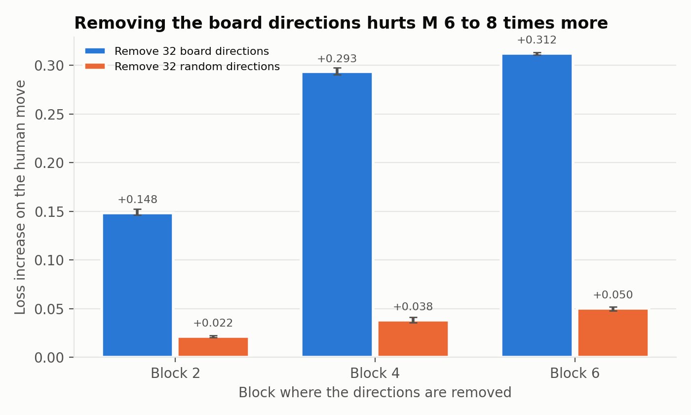
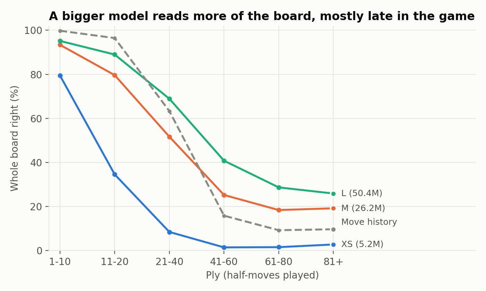
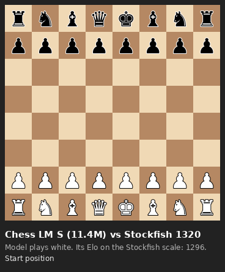
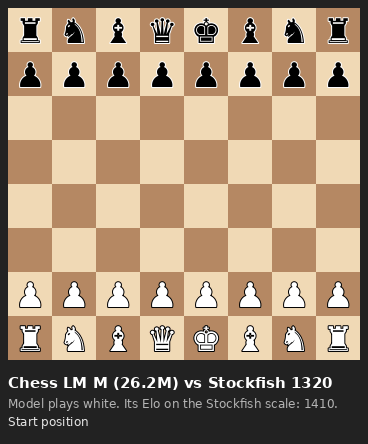

# Small GPTs that learn chess from move lists

We trained four small GPT models on chess games. They read the moves of a game and predict the next move.
They get no board and no rules. This post covers three questions:

1. How does the model improve with size?
2. How well does it play?
3. Does it build a picture of the board inside?

Code, logs and weights: <https://github.com/AshishSinha5/chess-lm> and <https://huggingface.co/sinha/chess-lm>.

## What we built

The pipeline. The top path is the player. The bottom path is how we look inside.

- **Data.** Games from the Lichess open database (CC0), months 2026-08 and 2026-09. Both players are rated 1800 or more. We use 22.4M training games, 1.64B tokens.
- **Tokens.** One token per move in UCI form, such as `e2e4`. The vocabulary has 1,971 tokens.
- **Models.** A plain decoder-only transformer. Each run reads 1B tokens, one pass, with no repeated game.

| Model | Parameters | Layers | Width |
|---|---|---|---|
| XS | 5.2M | 6 | 256 |
| S | 11.4M | 6 | 384 |
| M | 26.2M | 8 | 512 |
| L | 50.4M | 10 | 640 |

We train only on human moves. The model learns to predict what a strong amateur plays, not what is best.

## 1. Loss falls with size, and the last step is small

The loss is the cross-entropy per move on games the model never saw. Lower is better.

| Model | Loss per move | Step from the model before |
|---|---|---|
| XS | 1.789 | |
| S | 1.643 | 0.146 |
| M | 1.519 | 0.124 |
| L | 1.465 | 0.054 |

The step from M to L is less than half of the steps before it. A second seed moves each loss by 0.002 to 0.006, so the small step is real.

We looked for the cause and found two answers that are wrong.

- **Not the learning rate.** We trained L again at half the rate. The loss at 1B tokens changed by only 0.008.
- **Not too little data.** L may need more data than M. If so, a longer run should widen its lead. We trained both on all 1.6B tokens.

| | 1B tokens | 1.6B tokens |
|---|---|---|
| M | 1.519 | 1.482 |
| L | 1.465 | 1.431 |
| L lead over M | 0.054 | 0.051 |

The lead did not grow. The token sweep agrees: every size still gains from more tokens, but L gains slightly less than M.

**Our best guess, not tested.** The data are human moves. Strong players pick between several good moves at random.
No model can remove that part of the loss. The loss steps and the Elo steps both flatten near L, which fits a noise floor.
A second, less likely cause is the shape of L (depth against width). We did not test either cause.

## 2. Strength against Stockfish

We played each model against Stockfish 19 with its `UCI_Elo` limit set to 1320 and 1500. Stockfish gets 0.05 seconds per move.
The first 6 plies (half-moves) come from real games. The models play both colours. Each model plays 400 games.

The models do not know the rules, so they sometimes name an illegal move. We score the games two ways.

- **Lenient rule.** The program skips an illegal top move and plays the model's best legal move.
- **Strict rule.** A game with one illegal top move counts as a loss for the model.

| Model | Top move legal | Elo, lenient | Elo, strict | Games with an illegal move |
|---|---|---|---|---|
| XS | 98.4% | 1182 | 934 | 333 of 400 |
| S | 99.4% | 1296 | 1113 | 273 of 400 |
| M | 99.6% | 1410 | 1300 | 176 of 400 |
| L | 99.5% | 1479 | 1376 | 149 of 400 |

- A small error rate adds up over a game. Even L makes at least one illegal top move in 37% of games.
- The legal-move filter is worth 78 Elo for L and 250 Elo for XS.
- The strict numbers come from a rerun of the games, and Stockfish is not seeded. The lenient rerun agrees with the first run within its 95% interval.

**Read the Elo with care.** It sits on Stockfish's nominal scale, and Stockfish at 0.05 seconds plays below its nominal level.
It is not a Lichess or FIDE rating. Use it to compare our models with each other.

The GIFs at the end of the post show each model in a short game.

## 3. Is there a board inside?

The model never sees a board. It sees a list of moves. To play well, it may keep track of where the pieces are.
We test this with a **probe**. A probe is a small model that reads the hidden state of the network at one point.
Here it tries to name the piece on each of the 64 squares. We train it on one set of games and score it on other games.

A probe can mislead. It may learn the board by itself, and the network may have no board at all. So we run controls:

- a probe on a model with random weights;
- a probe trained on shuffled board labels;
- a probe that sees only the move list, with no network (**move history**).

One test game. The top row is the true board. The bottom row is what the probe on M reads. Orange marks a wrong square.

### The board is there

For M, the best linear probe reads 98.5% of squares right. It gets the whole board right in 53.8% of positions.
The controls stay far below this. The shuffled-label probe scores about 0.16 in balanced accuracy, against 0.95 for the real probe.
Most of our results use a plain linear probe. A linear probe finds the board only if the network keeps it in an easy form.

### The model uses it

A probe shows that the information is there. It does not show that the model uses it.
We removed the 32 directions in the hidden state that the probe uses for the board, and let M continue. Then we measured the loss.

Removing the board directions hurts far more than removing random directions. We checked one weakness of that test.
The board directions carry more variance than random ones, and removing variance alone could hurt. So we also removed random directions with the same variance.
The board directions still hurt 3.7 to 6.7 times more. M uses the board to choose its moves.

### Later in the game, the board beats bookkeeping

Early in a game, the move-history control does very well. It can follow a few moves by itself.
It has no board rules, so it loses track in long games, and M's probe does better.
We count in plies, where one ply is one half-move. M beats the control from ply 41 on.

### A bigger model builds a better board

| | XS | M | L |
|---|---|---|---|
| Linear probe, balanced accuracy | 0.866 | 0.952 | 0.968 |
| Whole board right | 23.6% | 53.8% | 65.1% |
| Beats move history from | never | ply 41 | ply 21 |

XS never beats the bookkeeping control. L beats it from ply 21. Queens are the hardest piece at every size.
L has a clearly better board than M, yet its loss is only 0.054 lower. We do not know why.

## Surprises and failures

- **A false alarm.** A first test with 300 games showed a random-weight model close to the trained one. The full run with 20k games did not.
  The small test had too few positions, and the probe did not train long enough. A probe needs enough data before its result means anything.
- **White and black, not mine and theirs.** In Othello-GPT, the board is stored as "my pieces and their pieces". M stores white and black.
  The white/black target scores 0.952. The player-relative target scores 0.933.
- **The most common probe error is the wrong colour.** The probe often finds the right piece type and gets its colour wrong.
- **The small step from M to L has no known cause.** We ruled out two causes and wrote a guess for the rest.

## Limits

- One seed for each model. Seed 1 is only for the loss at 1B tokens, not for the probes or the games.
- S was not probed. The intervention ran on M only, so "L uses its board" is not tested.
- The Elo uses Stockfish at 0.05 seconds, with 400 games per model. It is not a human rating.
- The models read only the move list. They do not search, so they play weak chess by engine standards.
- The noise-floor cause for the small M-to-L step is a guess.

## Try it

Each GIF shows a model as white against Stockfish at 1320, for the first 8 moves.

| XS | S | M | L |
|---|---|---|---|
|  |  |  |  |

To play a model yourself:

1. Clone the repo and run `pip install -e . safetensors huggingface_hub`.
2. Run `python scripts/play_gui.py --size l`. The script downloads the weights from Hugging Face.
3. Open `http://127.0.0.1:8000` and click to move.

The weights are in `sinha/chess-lm` (Apache 2.0), one folder for each size.

## Where to read more

Everything here is logged. `DECISIONS.md` has each choice and its result (G13 to G28).
`docs/PROBING.md` teaches the probing method from the start, with the reading list.
`results/EXPERIMENT_LOG.md` has every command and number.
