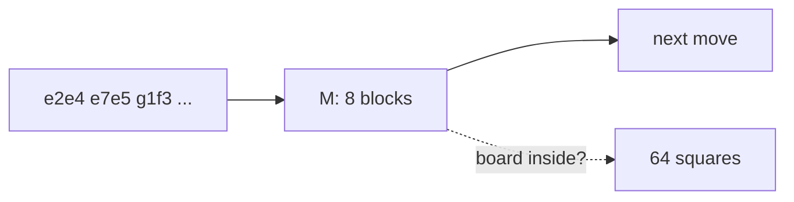
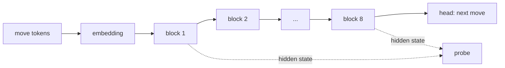
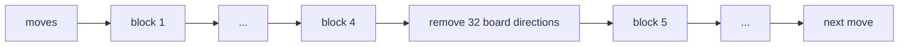
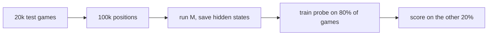
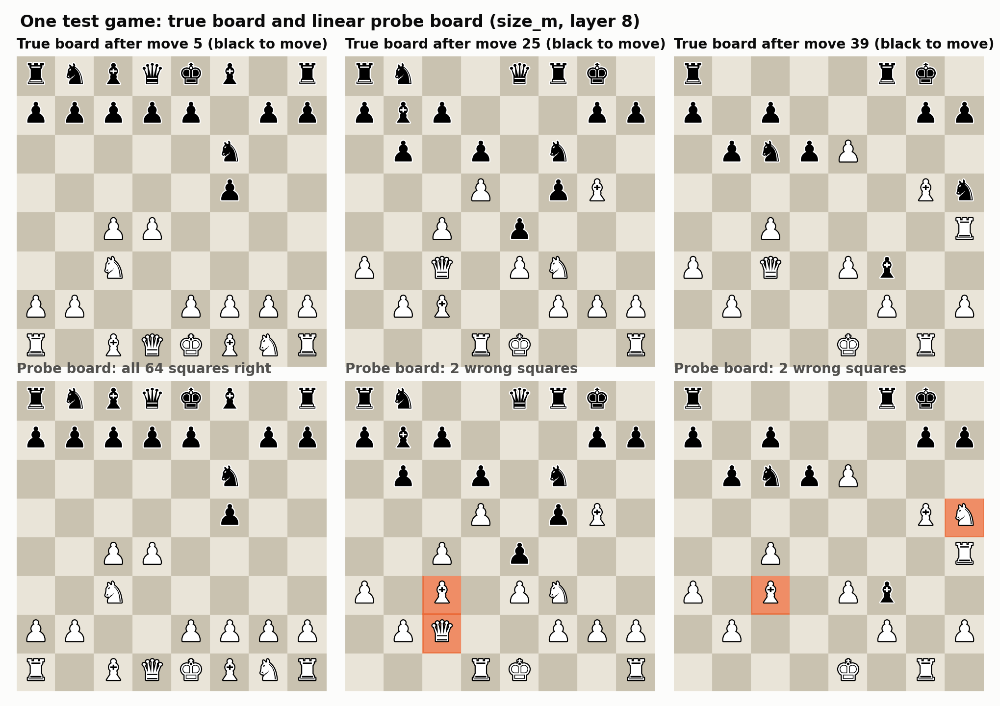
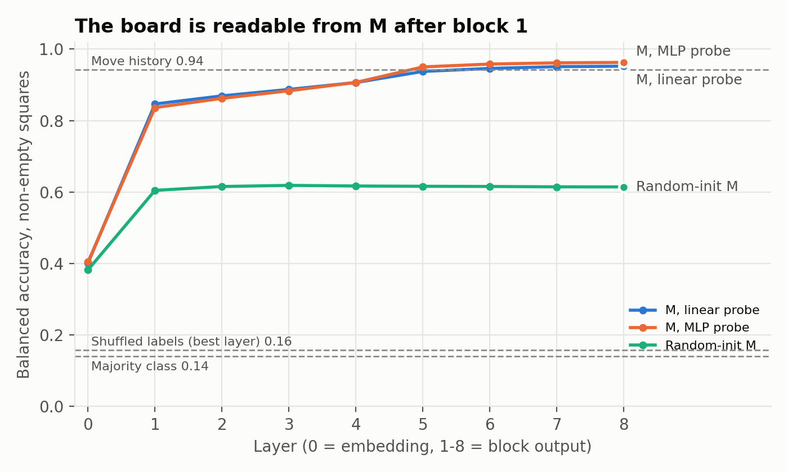
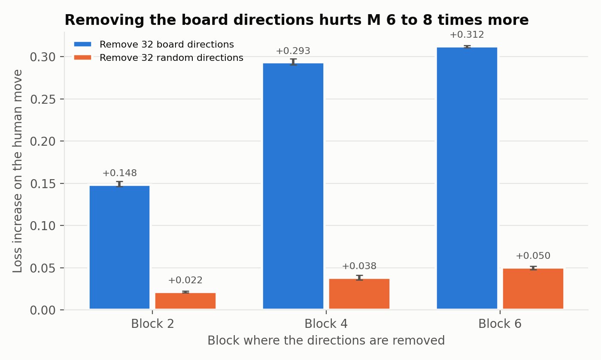
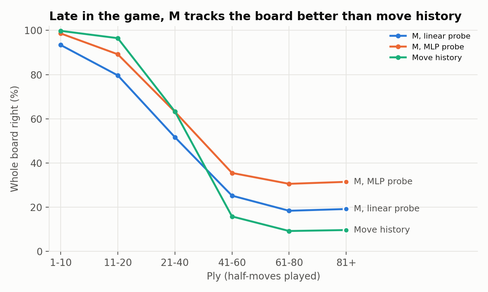
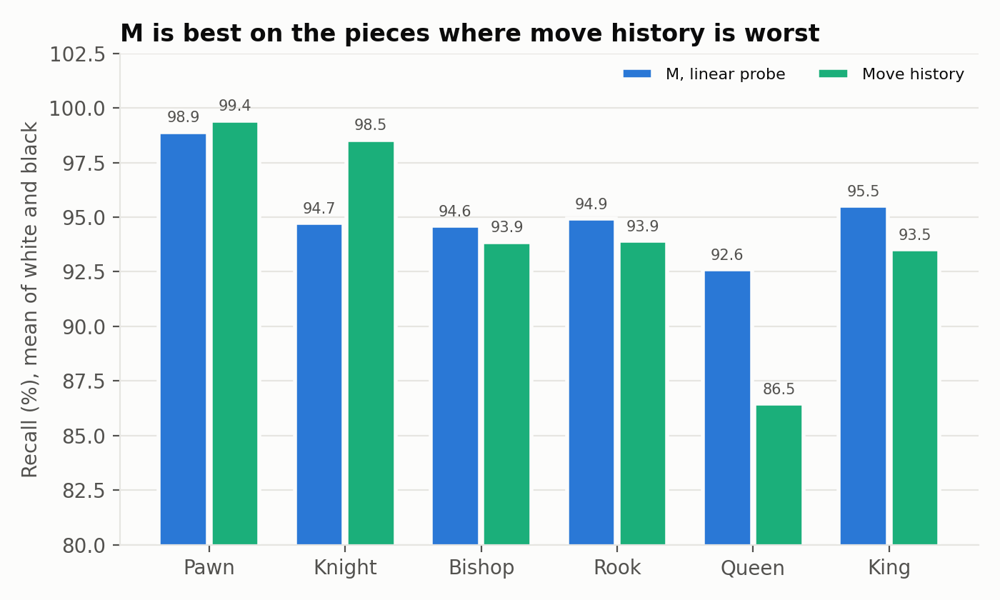
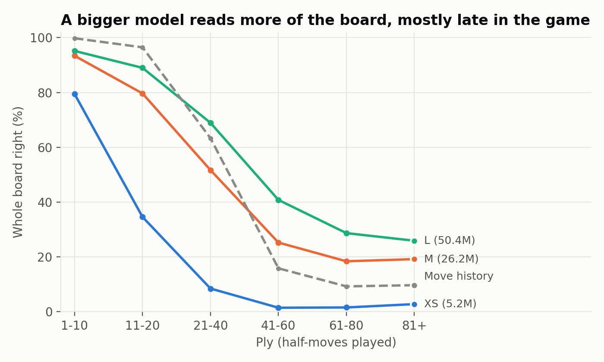

# Probing: does the model build a board?

Status: draft. Sections 3 (worked example) and 9 (board by size) wait for new data. The other sections are written.
Design: `DECISIONS.md` G21. Result: G23. Numbers: `results/probe/`. Code: `src/chesslm/probe/`.

## 1. The question


The question. M reads only move tokens. Does it build the board inside?

M is a model with 26M parameters. It reads a game as a list of move tokens, for example `e2e4 e7e5 g1f3`.
It never sees a board. Its only task is to predict the next move.

To predict a legal move late in a game, a player must know where the pieces are.
M could do this in 2 ways:
- **Board:** M keeps a picture of the 64 squares and updates it after each move.
- **Bookkeeping:** M only remembers surface facts, for example "a piece left e2, so e2 is empty".

Probing tests which way M works. This is the same question that Othello-GPT asks for the game Othello (section 13).

The answer has 3 parts:
1. **Present** (section 6): a weak probe reads the board from M.
2. **Beyond bookkeeping** (section 8): late in a game, M knows the board better than move bookkeeping does.
3. **Used** (section 7): when we remove the board from M, M chooses worse moves.

## 2. Concepts

### 2.1 Hidden state


Where the probe reads from M. M has 8 blocks. Each arrow carries 512 numbers per token.

The **hidden state** is the list of numbers that the model passes from one block to the next.
In M it has 512 numbers for each token.
The **residual stream** is the name for this hidden state as it passes through the blocks.
Each block reads from it and adds its own output to it.

### 2.2 Probe

A **probe** is a small model that reads a hidden state and predicts a fact about the position.
Here the fact is the piece on each of the 64 squares.
Each square has 13 classes: empty, or one of 6 piece types in white or black.

We train the probe and keep M frozen.
If the probe reads the board well, the board is in the hidden state.
The probe does not change M.

### 2.3 Linear probe and MLP probe

```
LINEAR probe:  512 numbers --[ W: 512 x 832 ]--> 832 scores --> 64 squares x 13 classes

MLP probe:     512 numbers --[ 512 x 1024 ]--> 1024 numbers --[ GELU ]--[ 1024 x 832 ]--> 832 scores
                                              (hidden layer)  (non-linear step)
```
The two probe types. Both read the same 512 numbers and give the same 832 scores.

- **Linear probe:** each score is a weighted sum of the 512 numbers.
  It finds only information that lies along fixed directions in the hidden state.
- **MLP probe:** it adds one hidden layer and a non-linear step (GELU).
  It can combine numbers, for example "this AND that, but NOT the other".
  So it can find information that M stores in a more complex form.

The gap between the two tells us how M stores the board:

| Result | Meaning |
|---|---|
| MLP much better than linear | The board is in M, but in a complex form |
| MLP about equal to linear (M: 0.963 against 0.952) | The board is in a simple, linear form |

The linear probe is the main result because it is weak.
A weak probe cannot compute the board by itself.
So if it reads the board, M laid the board out clearly.

### 2.4 Direction

The hidden state is a point in a space with 512 dimensions.
A **direction** is an arrow in that space.
The value of the hidden state along a direction is one number.

```
hidden state h = (x, y, z)
        z
        |   * h               remove the z direction:
        |  /                  keep x and y, set z to its mean value
        | /                   -> h' = (x, y, z_mean)
        +--------- y          the information in z is now gone
       /
      x
```
The idea in 3 dimensions. M has 512 dimensions, and we remove 32 of them.

### 2.5 SVD: which directions the probe uses

The linear probe has a weight matrix W with 832 rows and 512 columns.
**SVD** (singular value decomposition) is a standard matrix method.
It splits W into directions in the 512-dimensional space, sorted by importance.
The importance of a direction is its **singular value**.

We keep the top 32 directions.
These are the **board directions**: the directions that the probe uses most to read the board.
The probe weights span all 512 directions, so removing all of them would remove everything.
The top 32 carry most of the signal.

### 2.6 Removal and the random control


The intervention at layer 4. The other 480 directions stay the same.

1. Run M on a game up to block k.
2. At block k, take the hidden state. Along each of the 32 board directions, set its value to the mean over many positions.
3. Let M continue through the remaining blocks from the changed hidden state.
4. Measure the loss on the human move, the legal-move rate and the board probe at the last layer.

A **hook** is a function that changes a block output during the forward pass.
We use a hook, so the weights of M do not change.

The **random control** removes 32 random directions instead.
Removing any 32 of 512 directions loses some information, so M gets a little worse in both cases.
If the board directions hurt much more than random directions, M depends on the board information.

In code, `projector_hook` in `src/chesslm/probe/run.py` does step 2.
The SVD is in `cmd_intervene` in the same file.

## 3. Method


The probing pipeline. Code: `src/chesslm/probe/`. Command: `python -m chesslm.probe.run layers --ckpt size_m --mlp`.

1. Take 20k games from the test split. No model trains or evaluates on these games.
2. From each game, pick up to 5 random positions. This gives about 100k positions.
   A position after k moves is the hidden state at move token k, where M predicts move k+1.
3. For each position, store the true board: the class of each of the 64 squares.
4. Run M on each game. Save the hidden state at each layer (0 to 8). This is the **cache**.
5. Split the positions 80/20 **by game**. No game is in both parts, so the probe cannot memorize a game.
6. Train one probe for each layer on the 80% part. Score it on the 20% part.

The probes train on the cache, so they do not run M again.

### 3.1 A worked example: one test game


The true board (top) and the linear probe board (bottom) for 3 positions of one test game. A wrong square has an orange mark.

The game is a test game, so the probe never saw it. The game begins `d2d4 f7f5 c2c4 g8f6 b1c3 e7e6 c1g5 f8b4 d1c2 b7b6` and has 39 moves.
The probe is the linear probe on layer 8 of M, trained on the 80% train games. We did not pick the best game.
The script picks the test game whose mean number of wrong squares is closest to the mean for all test positions (0.96 per position).
Code: `python -m chesslm.probe.example`. Data: `results/probe/example_game.csv`.

1. **After move 5.** The probe reads all 64 squares right.
2. **After move 25.** The probe swaps two pieces. It puts the white bishop on c3 and the white queen on c2. The true board has the queen on c3 and the bishop on c2.
   Both pieces are white, and both squares are occupied. The probe finds the pieces but mixes up which is which.
3. **After move 39.** The probe makes the same swap on c3. It also shows a white knight on h5, where the true piece is a black knight.
   This is the "right piece type, wrong colour" error from section 8.1.

The 3 positions have 0, 2 and 2 wrong squares. Over all test positions, the probe reads 98.5% of squares right.
It reads all 64 squares right in 53.9% of positions. One wrong square in 64 is enough to break a position.

## 4. Metrics

| Metric | What it counts | M, layer 8 |
|---|---|---|
| Accuracy | Right squares, out of all 64 squares | 0.985 |
| **Balanced accuracy** (main) | Recall for each of the 12 piece classes, then the mean | 0.952 |
| Whole-board match | Positions with all 64 squares right | 53.8% |

The 3 metrics. Balanced accuracy is the main metric.

**Recall** for a class is the share of its squares that the probe gets right.
For example, a recall of 0.93 for the white queen means the probe finds the white queen in 93% of cases.

**Why accuracy alone misleads:** most squares are empty.
A probe that knows nothing about the moves still scores 0.67 accuracy, because it predicts "empty" where squares are mostly empty.
Even the embedding layer, which sees only the current move token and its position, scores 0.72.
Balanced accuracy ignores empty squares and gives each piece class the same weight.
So "empty everywhere" scores near 0, not 0.67.

**Whole-board match** is the strictest metric. One wrong square in 64 makes the position count as wrong.

## 5. Controls

A **control** is a run that should fail. If a control scores high, the probe result does not mean what we think.
Each control rules out one false explanation.

| Control | What it does | What it rules out | Balanced accuracy |
|---|---|---|---|
| Majority class | For each square, always predicts its most common class | The task is easy without M | 0.141 |
| Shuffled labels | Trains the probe on boards from other positions | The probe memorizes boards by itself | 0.155 to 0.158 |
| Embedding only | Probes layer 0, before any block | The current move token alone gives the board | 0.401 |
| Random-init M | Same architecture as M, with random weights, not trained | The architecture alone gives the board | 0.614 (best layer) |
| Move history | A probe on hand-made move features, no M | Simple bookkeeping of moves gives the board | 0.943 |

The 5 controls. The trained M scores 0.952. Numbers: `results/probe/controls.csv`.

- The first 3 controls fail clearly, as expected.
- **Random-init M** scores 0.61, higher than you might expect.
  A random network still mixes the move tokens, and a probe with 80k examples finds some board facts in that mix.
  Training adds 0.34 on top. This gap is the signal that training creates.
- **Move history** is the strongest control. It is close to M overall (0.943 against 0.952).
  For each square, it knows the last event (untouched, vacated, white piece arrived, black piece arrived) and the from-square of the last move to arrive there.
  It does no board simulation. Section 8 shows where it fails.

## 6. Result 1: the board is present



Balanced accuracy of the board probe at each layer of M, against the controls.

| Layer | 0 | 1 | 2 | 4 | 6 | 8 |
|---|---|---|---|---|---|---|
| Linear probe | 0.401 | 0.846 | 0.869 | 0.907 | 0.946 | **0.952** |
| MLP probe | 0.404 | 0.836 | 0.862 | 0.907 | 0.958 | **0.963** |
| Random-init M | 0.382 | 0.605 | 0.616 | 0.617 | 0.616 | 0.614 |

Balanced accuracy by layer. Numbers: `results/probe/probe_by_layer.csv`.

- **The board appears in block 1.** Balanced accuracy jumps from 0.40 to 0.85 in the first block. The other 7 blocks add only 0.10.
- **The board is linear.** The MLP probe gains only 0.011 at layer 8. A weighted sum reads almost all of it.
- **Training creates it.** Random-init M stays flat at about 0.61 at every layer. Trained M is 0.34 higher.
- **The best layer is the last.** The board gets better up to layer 8. It is still there when M predicts the move.

## 7. Result 3: M uses the board



Loss increase after removing 32 directions. Bars are the mean of 3 seeds, and the error bars show the range. The third bar removes random directions with the same variance as the board directions.

Removing 32 directions at one block, mean of 3 seeds. With no change the loss is 1.507 and 99.5% of moves are legal.

| Block | Removed | Loss increase | Legal moves | Same move as human | Whole board at last layer |
|---|---|---|---|---|---|
| 2 | board directions | **+0.148** | 98.8% | 48.5% | 18.9% |
| 2 | random directions | +0.022 | 99.5% | 51.1% | 45.3% |
| 2 | random, same variance | +0.040 | 99.4% | 50.7% | 38.5% |
| 4 | board directions | **+0.293** | 97.8% | 45.7% | 1.8% |
| 4 | random directions | +0.038 | 99.4% | 50.8% | 40.7% |
| 4 | random, same variance | +0.044 | 99.4% | 50.6% | 39.2% |
| 6 | board directions | **+0.312** | 98.3% | 44.6% | 0.0% |
| 6 | random directions | +0.050 | 99.4% | 50.5% | 33.3% |
| 6 | random, same variance | +0.063 | 99.4% | 50.2% | 28.4% |

- Removing the board directions raises the loss 6 to 8 times more than removing random directions, and 3.7 to 6.7 times more than random directions with the same variance.
- It removes the board from the later layers (0% to 2% whole-board match). Random removal leaves most of the board.
- The 3 seeds agree within 0.005 in loss.

So M uses the board information to choose its moves.

The same-variance control (DECISIONS G26) tests a weakness of the plain random control.
The board directions carry more hidden-state variance than random directions: 8% to 10% of the total, against 6.4%.
Removing high-variance directions can hurt more for that reason alone.
The control draws random directions with the same variance as the board directions, then removes them.
It raises the random loss a little (+0.040, +0.044, +0.063).
The board directions still hurt 3.7, 6.7 and 5.0 times more, so the board effect is not a variance effect.

At rank 128, random directions already carry more variance (25.5%) than the board directions (14% to 21%), so the control equals plain random.
The board directions still hurt more at rank 128, but rank 128 stays a poor comparison.

## 8. Result 2: beyond move bookkeeping



Share of positions with all 64 squares right, by ply, at layer 8 of M against the move-history baseline.

A **ply** is one move by one player. Ply 40 is after 20 moves by each side.

| Ply | Linear probe | MLP probe | Move history |
|---|---|---|---|
| 1-10 | 93% | 99% | **100%** |
| 11-20 | 80% | 89% | **96%** |
| 21-40 | 52% | 63% | 63% |
| 41-60 | 25% | **36%** | 16% |
| 61-80 | 18% | **31%** | 9% |
| 81+ | 19% | **31%** | 10% |

Whole-board match by ply, layer 8. Numbers: `results/probe/probe_by_ply.csv`.

Over all positions, move history gets the whole board right more often than the linear probe (57.9% against 53.8%).
But the two fail at different times:
- **Early (ply 1 to 20):** move history is almost perfect. Few pieces have moved, and each from-square names its piece.
- **Late (after about ply 30):** move history falls fast. M falls more slowly.
  After ply 40, the linear probe on M is right 1.6 to 2 times as often. The MLP probe is right 2 to 3 times as often.

Why bookkeeping fails late:
- A from-square names a piece only if that piece started there. After many moves, a square has seen several pieces.
- Castling moves the rook with no rook move in the token list.
- En passant removes a pawn from a square that the move does not name.
- Promotions change a pawn into another piece.

M must track these to know the board late in a game. Its higher score late in the game shows that it does, at least in part.

The MLP probe gains more late in the game (31% against 19% after ply 80) than early.
So the late-game board is partly stored in a form that a weighted sum cannot read.

### 8.1 Errors by piece type

```
true board        probe says        error kind
  [N]        ->      [B]            wrong piece   (a piece, but the wrong class)
  [N]        ->      [ ]            missed piece  (the probe forgets a piece that is there)
  [ ]        ->      [N]            ghost piece   (the probe keeps a piece that left)
```
The 3 error kinds. Numbers: `results/probe/errors_by_piece.csv`, `ghosts.csv`, `confusion.csv`. Decision entry: G25.

| Piece | Linear probe on M | Move history |
|---|---|---|
| Pawn | 0.989 | **0.994** |
| Knight | 0.948 | **0.984** |
| Bishop | **0.946** | 0.938 |
| Rook | **0.948** | 0.939 |
| Queen | **0.925** | 0.861 |
| King | **0.952** | 0.936 |

Recall by piece type, white pieces at layer 8. Black pieces give the same pattern.



Recall by piece type, mean of white and black. The axis starts at 80%.

- Move history knows where pieces moved, but not which piece moved.
  Pawns and knights have few start squares, so their from-square names them.
  Queens, rooks and bishops move far, and castling moves a rook with no rook move of its own.
  M is better exactly on these pieces.
- The most common probe error is the right piece type with the wrong colour (about 2%).
  One possible reason: M stores piece type and colour along partly separate directions. This is not tested.
- Queen errors go to rook and bishop, the two pieces that move like parts of a queen.
- Ghost pieces are 3 times more common on squares that a piece left (0.62%) than on squares no move touched (0.19%).

## 9. Board by model size


Whole board right, by ply. Linear probe at the best layer of each model. The dashed line is the move-history control.

We ran the same probes on XS (5.2M) and L (50.4M), with the same 20k test games and the same 5 controls (DECISIONS G27).
S was not probed.

| | XS | M | L |
|---|---|---|---|
| Best layer of the linear probe | 6 of 6 | 8 of 8 | 9 of 10 |
| Linear probe, balanced accuracy | 0.866 | 0.952 | 0.968 |
| MLP probe, balanced accuracy | 0.929 | 0.963 | 0.973 |
| Linear probe, whole board right | 23.6% | 53.8% | 65.1% |
| Whole board right, plies 41 to 60 | 1.5% | 25.3% | 40.8% |
| Move history, balanced accuracy | 0.943 | 0.943 | 0.943 |
| Random-init model, best layer | 0.545 | 0.619 | 0.640 |
| Shuffled labels, best layer | 0.148 | 0.158 | 0.163 |

- **The board gets better with size.** Balanced accuracy rises from 0.866 to 0.952 to 0.968. The whole-board score rises from 24% to 54% to 65%.
- **The gap between M and L is smaller than between XS and M.** The step from XS to M is 0.086 in balanced accuracy. The step from M to L is 0.016.
- **XS never beats move bookkeeping.** At every ply range, the XS probe scores below the move-history control.
  M beats it from ply 41. L beats it from ply 21 (0.979 against 0.969 in balanced accuracy at plies 21 to 40).
- **The controls hold at every size.** Shuffled labels score about 0.15 to 0.16. The embedding-only control scores about 0.40.
  The random-init control rises a little with size (0.545 to 0.640). All three stay far below the trained models.
- **The colour question.** For M and L, the absolute target (white and black) beats the player-relative target (0.952 against 0.933, 0.968 against 0.948).
  For XS the two are about equal (0.866 and 0.872). The white and black form appears as the model grows. We tested only 3 sizes, so this is a note and not a result.
- **Queens stay the hardest piece at every size.** Recall for queens is 81.8% (XS), 92.6% (M) and 94.8% (L), against 86.5% for move history.
  The probe on M and L beats move history on bishops, rooks, queens and kings. It does not beat move history on pawns and knights.
  XS is below move history on every piece type.
- **Ghost pieces fall with size.** On squares that a piece left, the ghost rate is 2.7% (XS), 0.62% (M) and 0.32% (L), against 0.24% for move history.
  On squares no move touched, it is 0.61%, 0.19% and 0.13%, against 0.05%.

Link to loss. L has a clearly better board than M, yet its loss is only 0.054 lower (G13).
So the board improves more than the loss does between M and L. This does not tell us why the loss step is small (G24).

## 10. Surprises

- **White and black, not mine and theirs.** Othello-GPT stores its board as "mine and theirs", relative to the player to move.
  M stores it as white and black. The absolute target scores 0.952. The player-relative target scores 0.933.
  One possible reason: in chess, white and black pieces are different from the start. In Othello, all pieces are the same until they flip.
- **The board is almost linear.** In Othello-GPT, the first studies needed a non-linear probe. The linear form appeared only with the mine/theirs target.
  In M, the linear probe works with the plain white/black target.
- **The board appears early.** After block 1 the probe scores 0.85, against 0.95 at the end. The later blocks add detail, mostly for late-game positions.
- **The false alarm.** A first test with only 300 games showed random-init M close to trained M.
  The full run with 20k games did not confirm it. The small test had too few positions, and its probe did not train long enough.
  Lesson: a probe needs enough data and enough steps before its result means anything.
- **The colour error.** The most common probe error is the right piece type with the wrong colour (section 8.1).

## 11. Limits

- **The variance-matched control is partial.** It matches the total variance of the 32 directions, not each direction one by one.
  It does not match the variance in the directions that matter for the next move.
- **Three models, one seed each.** M, L and XS are probed with training seed 0. S is not probed. The intervention (section 7) is only on M.
- **The rank choice.** We remove 32 directions. Rank 128 hurts a lot even with random directions, so it gives no clean comparison.
  Other ranks are not tested.
- **The move-history baseline is hand-made.** A better bookkeeping method could close part of the late-game gap.
  It still could not handle castling or en passant without board rules.
- **A probe shows that information is present, not that M uses it.** The intervention (section 7) gives the "used" evidence.
  It is the stronger claim, and it depends on the control above.

## 12. Open questions

- Does the board directions result hold against variance-matched random directions? Yes, by 3.7 to 6.7 times (section 7, DECISIONS G26).
- Does the board get better with model size? Yes: 0.866, 0.952, 0.968 in balanced accuracy for XS, M and L (section 9).
- Do L and XS show the same piece-type pattern? L yes (queens hardest, beats move history on bishops, rooks, queens, kings). XS is below move history on every piece type (section 9).
- Does the intervention result hold on L? Run the intervention on L. (not planned)
- Does M store piece type and colour separately? Probe type and colour as 2 separate targets. (not planned)
- Do M's illegal moves come from board errors? Compare illegal moves with probe errors in the same positions. (optional)
- Why is the late-game board partly non-linear? (not planned)

## 13. Reading list

Start with the first 2 for the main idea. Read the control-task paper before you trust any probe result.

| Topic | Paper |
|---|---|
| Othello-GPT: a board inside a move model | Li et al. 2023, "Emergent World Representations: Exploring a Sequence Model Trained on a Synthetic Task" |
| Othello-GPT is linear (mine/theirs) | Nanda, Lee and Wattenberg 2023, "Emergent Linear Representations in World Models of Self-Supervised Sequence Models" |
| The same question for chess | Karvonen 2024, "Emergent World Models and Latent Variable Estimation in Chess-Playing Language Models" |
| Chess as a state-tracking test | Toshniwal et al. 2022, "Chess as a Testbed for Language Model State Tracking" |
| Linear probes, the first idea | Alain and Bengio 2016, "Understanding Intermediate Layers Using Linear Classifier Probes" |
| Controls for probes | Hewitt and Liang 2019, "Designing and Interpreting Probes with Control Tasks" |
| Survey: what probes can and cannot show | Belinkov 2022, "Probing Classifiers: Promises, Shortcomings, and Advances" |
| Removing directions | Ravfogel et al. 2020, "Null It Out" (INLP); Elazar et al. 2021, "Amnesic Probing" |
| The residual stream | Elhage et al. 2021, "A Mathematical Framework for Transformer Circuits" |

Search terms: "linear probing world model", "probe selectivity", "causal intervention ablation", "residual stream".
