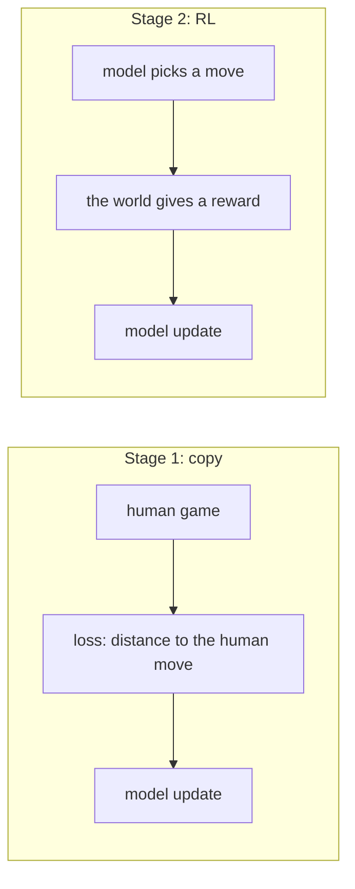
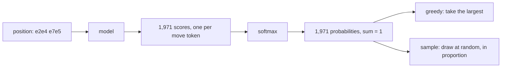
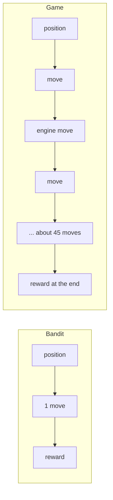
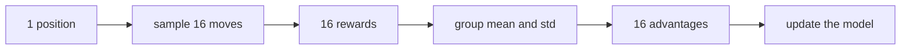
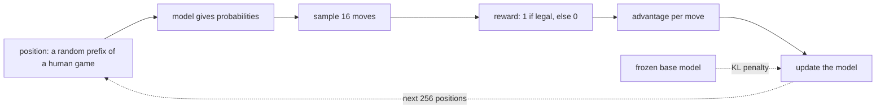
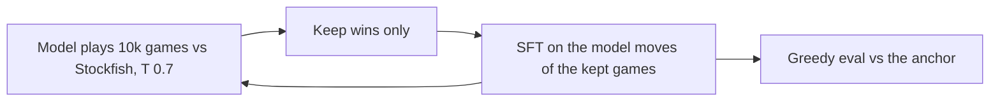

# Reinforcement learning: how the chess model learns from results

Status: draft. Sections 1 to 7 are written for the legality bandit (W4 step 4). Section 8 lists what is still to come. Each part is added after its step has run.
Plan: `docs/RL_PLAN.md`. Design: `DECISIONS.md` G32. Numbers: `results/rl/`. Code: `src/chesslm/rl/`.
You need no RL knowledge to read this doc. Every new term is explained where it first appears.

## 1. The question


Two ways to learn. Stage 1 learns from the answer. RL learns from a score for what the model tried.

In stage 1 the model saw millions of human games. For each position it was shown the human move. It learned to copy.
Copying has limits:
- The model never learns whether a move was **good**. It only learns that a human played it.
- The model never learns from its **own mistakes**. It sees only positions that humans reached.
- The model sometimes plays an **illegal move**. The training never punished that.

Reinforcement learning (RL) works in a different way.
The model tries something. A rule outside the model gives a **reward**, which is a number. The model changes so that high-reward tries become more likely.

This project asks 5 questions about RL (`docs/RL_PLAN.md`, Q1 to Q5):
1. Does RL make the model stronger?
2. Does RL cut the illegal moves?
3. What happens to the board that the model builds inside (`docs/PROBING.md`)?
4. Does the gain depend on the model size?
5. What does RL cost? (How far does the model move away from where it started?)

Before we let the model play real games, we run the smallest RL problem that we can make. It is the **legality bandit**. It tests the RL machinery, and it answers part of Q2.

## 2. Concepts

### 2.1 Policy and sampling


From position to move. The model gives a probability for each token. Greedy and sampling use these probabilities in different ways.

The **policy** is the model when it chooses moves. Given a position, the policy gives a probability for each of the 1,971 move tokens.
(The model makes a score for each token. The **softmax** step turns the scores into probabilities that add up to 1.)

There are 2 ways to pick a move:
- **Greedy:** take the token with the largest probability. The result is always the same for the same position.
- **Sample:** draw a token at random. A token with probability 0.30 is drawn in 30% of the draws.

RL needs sampling. The model must try different moves to find out which are better.

Only some tokens are legal in a given position. At the start of a game, 20 of the 1,971 tokens are legal. The other 1,951 are illegal: for example `e1e5` (a king cannot move 4 squares), and the special tokens `<pad>`, `<bos>` and `<eos>`.
The model gives a small probability to many illegal tokens. Each one is small. Together they add up.

### 2.2 Reward

The **reward** is a number that a rule gives after the model has tried something. The model does not see the rule. It sees only the number.
In the legality bandit the rule is simple: reward 1 if the move is legal, reward 0 if it is not.
In the real games (later) the rule is: win 1, draw 0.5, loss 0. An illegal move ends the game as a loss.

### 2.3 Bandit: RL with one step

A **bandit** is an RL problem with one decision and one reward. There is no "later". The name comes from the slot machine, the "one-armed bandit".
A chess game is different. It has about 45 decisions by the model, and one reward at the end.


A bandit has 1 step. A game has about 45 model moves and 1 reward at the end, so it is hard to tell which move deserves the credit.

We start with the bandit because it is small and fast. It has no engine. If the RL loss, the optimizer or the data have a bug, we see it here and not in a 40-hour run.

### 2.4 The update: policy gradient

The model learns from a try in this way:
- If the reward was **good**, raise the probability of the move that the model tried.
- If the reward was **bad**, lower that probability.

This is the **policy gradient**. The loss for one try is:

```
loss = - advantage x log( probability of the move )
```
(The **advantage** is how much better than usual the try was. Section 2.5 explains it.)
A step of gradient descent lowers the loss. If the advantage is positive, that raises the probability of the move. If the advantage is negative, it lowers the probability.

### 2.5 Group and advantage

A reward of 1 does not say much by itself. Most moves are legal. A reward of 1 is the normal result.
What matters is whether a move was **better or worse than the other moves at the same position**.

So we sample a **group** of moves at each position (16 in our runs). Then:

```
advantage = ( reward - mean of the group ) / ( std of the group )
```
(The **std**, standard deviation, measures how much the rewards differ inside the group.)


The group baseline. Each move is judged against the other moves from the same position.

This is the idea of **GRPO** (group relative policy optimization). It needs no second network that guesses the value of a position. The group itself is the comparison.
Two results follow:
- If all 16 moves are legal, all rewards are 1, the advantage is 0 for every move, and the model learns nothing from this position. There is nothing to compare.
- If 1 move out of 16 is illegal, that move gets a large negative advantage. It gets a strong push down.

This has a cost. For base M, 98.2% of the sampled moves are legal. So about 3 positions in 4 have an all-legal group and give no signal. For XS about 1 in 2 gives no signal. Learning is slow because the signal is rare.

### 2.6 KL penalty: do not drift too far

If we only chase the reward, the model can change in ways that we do not want. It may forget chess, or put all its probability on a few safe moves.

So we add a penalty for moving away from the **base model** (the model before RL, which stays frozen).
The distance is the **KL divergence**. It is a number in **nats**:
- KL = 0: the policy and the base model give the same probabilities.
- KL = 0.1: the policy is close but not the same. On average, it costs 0.1 nats of extra surprise to describe the policy's moves with the base model's probabilities.

The full loss is:

```
loss = - advantage x log( probability )  +  beta x KL
```
`beta` sets the weight. In our runs `beta` is 0.02.
We estimate the KL from the sampled moves with a cheap formula, the "k3 estimator" (Schulman, 2020).

### 2.7 Two legal rates

The word "legal rate" can mean two numbers. We keep both.

| Name | What it measures | XS base | M base |
|---|---|---|---|
| Top-1 legal rate | The most likely token is legal. This is the stage-1 number | 98.40% | 99.50% |
| Sampled legal rate | The share of probability on legal moves. This is how often a drawn move is legal | 95.73% | 98.23% |

The sampled rate is lower. It counts the many small chances on illegal tokens. It is the rate that decides how many games end on an illegal move, because RL games use sampling.

## 3. Method: the legality bandit


One step of the bandit. Each step uses 256 positions and 16 sampled moves per position.

Settings of the main runs: 300 steps, learning rate 3e-5, `beta` 0.02, AdamW. That is 76,800 positions and 1.2 million sampled moves. The run takes about 2 minutes. Code: `src/chesslm/rl/bandit.py`.

### 3.1 A worked example: one position, 4 moves

We use 4 moves here, to keep the numbers small. The real runs use 16.
Position: after `e2e4 e7e5`. The model samples 4 moves:

| Move | Legal? | Reward | Advantage |
|---|---|---|---|
| `g1f3` | yes | 1 | +0.5 |
| `b1c3` | yes | 1 | +0.5 |
| `d2d4` | yes | 1 | +0.5 |
| `e1e5` | no | 0 | -1.5 |

The group mean is 0.75. The std is 0.5. So the advantage of a legal move is (1 - 0.75) / 0.5 = +0.5, and that of the illegal move is (0 - 0.75) / 0.5 = -1.5.
The update lowers the probability of `e1e5` three times as hard as it raises the others. Next time, this model puts less probability on `e1e5`.
If all 4 moves had been legal, every advantage would be 0, and the model would not change.

## 4. Metrics

All metrics use 5,000 fixed positions from the validation games. The model never trains on them. The numbers are exact (we sum over all tokens, so there is no sampling noise).

| Metric | Meaning | Good direction |
|---|---|---|
| Sampled legal rate | Probability on legal moves | up |
| Top-1 legal rate | The most likely token is legal | up |
| Human match | The most likely token is the human move | stays about the same |
| Human-move loss | How surprised the model is by the human move. Lower is better | stays about the same (cost, Q5) |
| KL to base | How far the policy moved, in nats | small |

The last 3 rows measure the **cost** of the change. RL can raise legality by making the model worse at everything else.
The plan flags a rise in human-move loss of more than 0.1.

## 5. Result: the legality bandit

| Model | Step | Sampled legal rate | Top-1 legal rate | Human-move loss | KL to base |
|---|---|---|---|---|---|
| XS | 0 | 95.73% | 98.40% | 1.735 | 0 |
| XS | 300 | 97.54% | 99.18% | 1.813 (+0.078) | 0.094 |
| M | 0 | 98.23% | 99.50% | 1.498 | 0 |
| M | 300 | 99.31% | 99.88% | 1.544 (+0.046) | 0.062 |

The RL loop works. The legal rate rises, the cost is small, and the KL stays small. M reaches 99% on both rates. XS reaches 99% on the top-1 rate only.

### 5.1 Why 3% is a big number

A model that is wrong 3% of the time on each move is wrong in most games. A full game has about 45 model moves. The chance of 45 legal moves in a row is (1 - p)^45.

| Model | Illegal share per model move | Predicted games with no illegal move | Observed |
|---|---|---|---|
| XS base | 4.96% | 10% | 7% |
| XS after bandit | 3.31% | 22% | 21% |
| M base | 3.36% | 22% | 17% |
| M after bandit | 1.65% | 47% | 45% |

The prediction is rough (not every game has 45 moves), but it is close. So the small error per move is what ends most games on an illegal token. After the bandit, M finishes 45% of its sampled games without an illegal move. Before, it finished 17%.

Note: the held-out positions show 1.8% illegal for base M, and the games show 3.4%. Positions in games against an engine are harder than positions from human games. The held-out number under-predicts the in-game number by about 2 times.

### 5.2 XS stops at about 98%

We tried 3 learning rates on XS. A higher rate costs more and does not give more legality.

| Loss | Learning rate | Sampled legal rate | Human-move loss | KL to base |
|---|---|---|---|---|
| sampled (RL) | 3e-5 | 97.54% | 1.813 | 0.094 |
| sampled (RL) | 1e-4 | 98.14% | 2.016 | 0.285 |
| sampled (RL) | 3e-4 | 98.08% | 2.384 | 0.586 |
| exact mask | 3e-5 | 97.46% | 1.790 | 0.070 |
| exact mask | 1e-4 | 97.95% | 1.871 | 0.150 |

XS is a small model (5.2M parameters). It seems to have little room to push legality higher without changing how it plays.

### 5.3 A comparison that is not RL

The "exact mask" rows use a different loss: minus the log of the legal probability. It needs the answer for **all** 1,971 tokens at each position. The teacher says which tokens are legal. It is supervised learning, not RL.
RL learns by trying a few moves and getting a score. The exact-mask loss shows what is possible when the teacher gives the full answer.

Result: at the same learning rate, the exact loss gains the same legality (97.46% against 97.54%) with 30% less rise in human-move loss. So learning by trial costs a little more, but most of the cost comes from the task, not from the RL method. (One run each, so treat this as a hint.)

## 6. What this means for the next steps

- The RL loss, the optimizer and the KL term work. We can use them in the game loop.
- Games are the hard part. After the bandit, M still ends 55% of its sampled games on an illegal move. It scores 0.07 against Stockfish 1320 and 1500, while the greedy legal-move rule scores about 0.65. So the first rewards in GRPO are mostly 0.
- Two cheap levers for the first GRPO runs, to test before the long runs:
  - Start from the bandit checkpoint, not the base model.
  - Sample at a lower **temperature** (below 1). This makes the probabilities sharper, so rare illegal tokens are drawn less often.

## 7. Limits

- One run per setting. The comparisons between runs are hints, not proofs.
- We chose the learning rate on the same positions that we report. This is mild tuning on the test set. It is fine for a test of the loop. It is not a claim that we would generalize.
- The training positions come from human games only. Positions from games against an engine are harder (section 5.1). A bandit trained on those would fit the games better. We did not try it.
- We measured legality and the loss on human moves. We did not measure playing strength after the bandit.

## 8. Still to come

These parts are added after their steps run.
- **RFT** (rejection-sampling fine-tuning): play games, keep the wins, train on them. The simplest RL baseline.
- **GRPO on full games:** the real loop. A game has about 45 decisions and 1 reward. How does the model know which move earned the win? (credit assignment)
- **Rewards and reward hacking:** what the model does to get a high reward in a way we did not intend, for example draws by repetition.
- **Diversity:** does RL make the model play the same moves every time?
- **Probing the RL model:** does the board inside the model change (`docs/PROBING.md`)?
- **Why not PPO:** a method that needs a value network. We explain the choice.

## 9. Where each idea is in the code

| Idea | Where |
|---|---|
| Sample a move from the policy | `train_step` in `src/chesslm/rl/bandit.py` (in games: `play_games` in `rollout.py`) |
| Legal tokens at a position | `legal_mask` in `bandit.py` |
| Advantage in a group | `group_advantage` in `bandit.py` |
| KL penalty (k3) | `train_step` in `bandit.py` |
| Exact metrics | `evaluate` in `bandit.py` |
| Many games at once | `src/chesslm/rl/rollout.py` |
| Stockfish as the opponent | `src/chesslm/rl/engine_worker.py` |
| Tests | `tests/test_bandit.py`, `tests/test_rl.py` |

## 10. Reading list

Search for the title.
- Sutton and Barto, *Reinforcement Learning: An Introduction* (2nd edition, free online). Chapter 2 (bandits) and chapter 13 (policy gradient).
- OpenAI Spinning Up, "Intro to RL" and "Policy Gradient" pages. A short and clear start.
- Andrej Karpathy, "Deep Reinforcement Learning: Pong from Pixels" (blog, 2016). Policy gradient from first principles.
- Williams (1992), "Simple statistical gradient-following algorithms for connectionist reinforcement learning". The paper that introduced REINFORCE.
- John Schulman, "Approximating KL Divergence" (blog, 2020). The k3 estimator.
- Shao et al. (2024), "DeepSeekMath". The paper that introduced GRPO.


## 11. Step 5a: temperature and start point (2026-11-14)

Temperature T divides the logits before the softmax. A low T makes the model pick its likeliest moves, and illegal tokens become rare.

```
T 1.0  base M: Elo  864, 83% of games end on an illegal token
T 0.7  base M: Elo 1098, 64%
T 0.5  base M: Elo 1284, 51%
T 0.3  base M: Elo 1333, 48%   (close to greedy; bandit M: 18% illegal endings)
```

- Lesson 1: the same weights give Elo 864 at T 1.0 and about 1333 at T 0.3. Low T is close to greedy play, and stage-1 greedy strict gave 1333. So an RL gain must be compared with greedy strict, not with T 1.0.
- Lesson 2: GRPO needs games with different rewards. Very low T makes games alike. Very high T makes every game a loss. We pick T 0.7 as a first guess.
- Numbers: `results/EXPERIMENT_LOG.md` step 29, decision G33.


## 12. Step 5b: RFT (2026-11-14)

RFT is rejection-sampling fine-tuning. The model plays, we keep the games it won, and we train on its own moves from those games.


Caption: one round of RFT. We ran 4 rounds from base M.

- It is RL in the weakest sense. The reward only decides which games we keep. The loss is the ordinary next-move loss, so there is no advantage and no KL term.
- Result: the model wins more of its sampled games (12.6% to 17.1%), but its greedy Elo stays at the base level (strict about 1350, lenient about 1450). So the sampler improves and the greedy player does not.
- Lesson: a win rate at T 0.7 is not a strength measure. Always check the greedy anchor. Sharpening a distribution raises sampled results without a stronger player.
- What it cost: human-move loss +0.040 and KL to base 0.039 nats per position.
- Numbers: `results/EXPERIMENT_LOG.md` step 30, decision G34. Code: `src/chesslm/rl/rft.py`.


### Step 5b, part 2: did we pick a bad learning rate? (2026-11-14)

We trained base M on the same 1,256 won games at five learning-rate settings and measured the Elo of each.

```
lr 1e-5 / 3e-5 / 1e-4 (2 epochs)   Elo about the same as base M (1450 to 1456 lenient)
lr 3e-4 (2 epochs)                 worse: 1426
lr 1e-4 (6 epochs)                 worse: 1403
```

- Lesson 1: the learning rate was not the problem. A small step changes nothing, and a large step damages the model. RFT on this pile of wins gives no strength gain at any setting we tried.
- Lesson 2: a high learning rate makes the training loss fall fast (0.305), but that only means the model memorized the games.
- Lesson 3: a score measured on 400 games can be off by about 50 Elo. A single high number (round 3 at 1502) was luck. With 1,200 games all the rounds read about 1447.
