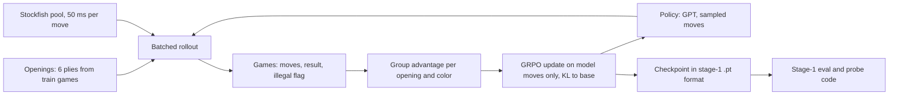

# RL post-training for Chess LM: plan

Source prompt: `docs/RL_PLAN_PROMPT.md` (the path in the command, `/workspace/chess-lm/RL_PLAN_PROMPT.md`, does not exist). Approved by the user on 2026-11-13.

## Context
Stage 1 (done, public) trained XS/S/M/L GPTs on Lichess move lists. Stage 2 adds RL post-training. Goal is unchanged: show depth with findings, ablations and honest analysis. The most original part is the link to stage 1: probe the board inside the RL models and ask what RL did to it.

State of the pod (checked 2026-11-13): one A100 80GB. `/workspace/ckpt` and `/workspace/bin/stockfish` are not on the volume. Only `data/small` and `data/lichess_1800` exist. The pod has an rclone remote `b2:`. It holds a full backup of the stage-1 pod at `b2:backity-backup/chess-lm-project/` (39 GB). The backup includes `ckpt/` (all stage-1 `.pt` checkpoints, 32 GB) and `bin/stockfish`.

The RL runs start from the stage-1 `.pt` checkpoints in B2. These are the same files that stage 1 used for Elo and probing. The public HF weights (`sinha/chess-lm`) hold the same 1B-token runs. They stay the reproducible path for readers without B2 access.

Facts from stage 1 that shape the design:
- Lenient Elo picks the best LEGAL move by score. So lenient Elo already equals "base model plus an inference-time legal mask". Strict Elo (illegal move = loss) is the raw model.
- So legality RL can at most close the strict-to-lenient gap (934 to 1182 XS, 1376 to 1479 L). Gain above the lenient Elo is real strength. The plan reports both and claims strength only from lenient.
- The harness plays one game at a time per worker (`eval/play.py`). RL needs batched rollouts.

## Goal and out of scope
Goal: post-train XS, M and L with RL against Stockfish. Measure strength, illegal moves, the internal board and the cost (KL, diversity).
Out of scope: MCTS or any search at inference, models above 50M parameters, beating strong engines, leaderboard Elo, human-feedback methods.

## Research questions and decision rules
Success threshold uses paired games (same openings and colors) and a paired bootstrap 95% interval.

| # | Question | Experiment | Yes if | No if |
|---|---|---|---|---|
| Q1 | Does RL raise strength? | GRPO on M, L, XS vs base and vs baselines. Lenient Elo | Gain of 40 Elo or more, interval excludes 0, and above the best baseline | Interval includes 0, or a baseline matches it |
| Q2 | Does RL cut illegal moves? | Strict Elo, illegal-top-move rate, bandit run | Illegal rate falls by half or more with no mask | Little change |
| Q3 | What happens to the board? | Re-run probes and intervention on RL models. Also apply the base probe to RL activations | Probe accuracy or intervention ratio differs from base by more than the seed spread (0.002 to 0.006 loss, probe seeds) | Within spread |
| Q4 | Does the gain depend on size? | Same recipe on XS, M, L | Gain differs by size, with intervals that do not overlap | Equal within intervals |
| Q5 | What does RL cost? | KL to base, entropy, distinct-move rate, validation loss on human games | Report the numbers. Flag KL above 5 nats per game or loss rise above 0.1 | n/a |

Predictions to write down before the runs (so we can be wrong in public): RL raises the board score a little and the intervention ratio stays above 1. [ASSUMPTION]

## Design


Caption: one RL loop. The checkpoint format stays the same, so the stage-1 eval and probe code runs unchanged.

### Algorithms (in order of cost)
| Method | What it does | Role |
|---|---|---|
| Legality bandit | At held-out positions, sample a move. Reward 1 if legal. No Stockfish | Fail-fast test. Teaches the RL loop on one step |
| RFT (expert iteration) | Play games, keep wins, run SFT on the model moves of those games | Simple RL baseline. Same game budget as GRPO |
| GRPO (main) | Play a group of games from one opening and color. Advantage = reward minus group mean, divided by group std. Add a KL penalty to the base model | Main method. No value network, so less to tune |
| PPO | Needs a value head and tuning | Not run. Explain in the teaching doc and in DECISIONS (G30). |

### Reward (outcome reward is the headline)
| Reward | Value | Teaches | Risk |
|---|---|---|---|
| Outcome (main) | Win 1, draw 0.5, loss 0. Illegal move ends the game as a loss (the stage-1 strict rule) | Win and stay legal | Sparse. Credit goes to all moves of a game |
| Outcome plus legality | Same, plus a small penalty per illegal token | Faster legality | Hides the cause of the gain |
| Stockfish eval change | Win-probability change per model move | Dense signal | Teacher signal. Distillation of Stockfish, not pure RL |
`PLAN.md` kept engine evals out of scope as model input. Decision: an engine reward is in scope for ONE ablation only, labeled "teacher reward". The headline uses outcome only. [ASSUMPTION]

### Opponent and the "always lose" problem
- Stockfish `UCI_Elo` mixture of 1320, 1500 and 1700. Same engine settings as the eval (1 thread, 50 ms).
- Stage-1 scores near 1320 to 1500 are far from 0%, so the reward is not all losses for M and L. XS (1182) may be near 20% against 1320. Check in W4.
- Fallback if the win rate is below 10%: add the random mover and Skill Level 0 to the mixture, then fade them out.
- Self-play is not used. No anchor, so no Elo claim.

### Starting points
M (main: stage-1 probe and intervention results exist), L (second), XS (fast tests and the size question). Use the 1B-token checkpoints from B2: `size_xs/final.pt` (63 MB), `size_m/final.pt` (314 MB), `size_l/final.pt` (605 MB). Stage-1 Elo and probe numbers come from these files, so the base numbers carry over without conversion. Optional: `full_m/final.pt` and `full_l/final.pt` (1.6B tokens) as a later check of whether RL gains depend on pretraining tokens. Download only the files the current step needs, not the full 32 GB `ckpt/`.

### KL control
Penalty is beta times the k3 estimator on model moves, against the frozen base model. Log KL per move and per game. Sweep beta in {0, 0.02, 0.1}. [ASSUMPTION: values need a pilot.]

### Baselines RL must beat (same game or token budget)
1. Base model, strict and lenient (the lenient number is the inference mask baseline).
2. RFT on own wins.
3. More SFT: continue stage-1 training for the same token count at a low learning rate.
4. SFT on human games of the winner only, using the existing shards.
5. Base model at a lower sampling temperature. This checks whether RL only sharpens the distribution.

### Evaluation
Reuse `eval/play.py`: `load_model`, `next_logits`, `choose_move_ex`, `val_games`, `parse_opponent`, `elo_with_ci`, `legal_rate`. Use the test split for openings, never the training openings. Opponents: 1320, 1500, 1700 (seen in training) and 1900 (not seen, to catch overfitting to the training opponents). 300 openings with both colors per opponent. Report strict and lenient Elo, legal rate, illegal-top-move rate, entropy, distinct-move rate and human-game loss.

Power check: 200 games per opponent gives about plus or minus 50 Elo [UNVERIFIED]. Use the paired design and 600 games per pair for the final models.

### Ablations (four, one factor each, on M)
Reward type, KL beta, opponent mixture (fixed 1320 vs mixture), model size (XS/M/L). Main run gets 3 seeds. Ablations get 1 seed.

## Milestones (three weekends, same as stage 1)
```
 W4 setup + bandit + RFT ──> W5 GRPO + ablations ──> W6 L/XS + probes + write-up
```
**W4: engine, fail-fast tests**
- New pod. Run `scripts/fetch_rl_inputs.sh` (new). It copies the three base checkpoints into `/workspace/ckpt/size_{xs,m,l}/` and Stockfish into `/workspace/bin/` from B2 with `rclone copy`. It skips files that exist. Check that the Stockfish binary runs and reports version 19; else install it with `apt-get`.
- Run the stage-1 eval on base M to confirm the stage-1 numbers.
- Batched rollout engine. Measure games per second.
- Legality bandit on XS, then M.
- RFT on M.
- Exit tests: (1) rollout masks opponent moves and keeps ply parity for both colors; (2) log-prob from rollout equals log-prob from the training forward pass; (3) an illegal token ends the game as a loss; (4) bandit raises the XS legal rate above 99% in a fixed budget; (5) GRPO on a random-mover opponent raises the win rate.
**W5: GRPO on M**
- Main run, 3 seeds. KL sweep. Reward ablation. Evals of all.
**W6: size, probes, write-up**
- L and XS. Opponent ablation. Probing of base and RL M, L and XS. Teaching doc. Follow-up blog draft (`docs/BLOG_RL.md`). Fresh-clone test with the new code.

## Infra and cost
Rollouts are CPU-bound (Stockfish), not GPU-bound. Estimate: a game is about 70 plies, 35 Stockfish moves at 50 ms is 1.75 s of CPU. With 12 vCPU that is about 7 games/s, about 24k games/hour. [UNVERIFIED. Measure in W4.]

| Item | Games or work | Hours | Cost at $2.20/hr |
|---|---|---|---|
| Setup and rollout speed test | 5k | 1 | 2 |
| Bandit XS and M | no engine | 1 | 2 |
| RFT M | 40k | 2 | 4 |
| GRPO M, 3 seeds | 50k each | 9 | 20 |
| Ablations, 4 runs on M | 40k each | 8 | 18 |
| GRPO L and XS | 50k each | 5 | 11 |
| Baselines (SFT) | token budget | 2 | 4 |
| Evals, about 15 models | 1.8k games each | 3 | 7 |
| Probing, 4 models | GPU | 4 | 9 |
| Total | | about 35 | about 77 |
The pod price rose from $1.80/hr to $2.20/hr (user, 2026-11-13). Stage 1 cap was $50. The estimate of $77 leaves almost no margin under $80, and the hours are not measured yet. Cap: $100 (user, 2026-11-13). Redo this table after the W4 speed test. Option: a cheaper GPU pod with the most vCPUs, since the model is small. Check price per vCPU. Stop the pod when idle. Train in `tmux`. No keys, IPs or checkpoints in git.

## Code layout (new files; reuse the rest)
- `src/chesslm/rl/rollout.py`: batched play. N games at once. One process pool for Stockfish. One batched forward pass on the GPU per ply. Reuses `next_logits`, `TOK`, `parse_opponent` from `eval/play.py`. Full recompute per ply is fine for 256 tokens [UNVERIFIED].
- `src/chesslm/rl/grpo.py`, `rft.py`, `bandit.py`, `reward.py`.
- `scripts/fetch_rl_inputs.sh`: B2 download of the base checkpoints and Stockfish. It reads the rclone remote from the pod config. It contains no keys or bucket credentials.
- `src/chesslm/rl/hf_load.py` (low priority, W6): safetensors to stage-1 `.pt` format, for readers who start from the HF weights. `scripts/export_hf.py` is the reverse. One test checks that the HF weights and the B2 checkpoint give the same logits.
- Saves `{"model_cfg", "model"}` so `eval.play.load_model` and `probe.run` work unchanged.
- `scripts/rl_*.sh` in the style of `size_sweep.sh`. `tests/test_rl.py` for the exit tests.
- Reuse the optimizer and schedule helpers in `train.py` (`lr_at`, `evaluate`).
- No edit to stage-1 files, except a `--ckpt` path option for probes if one is missing.

## Logging (fits the existing `results/` layout)
| Stage | Files in `results/rl/` |
|---|---|
| Training curves | `runs.csv`, `curves/` (reward, KL, entropy, win rate, illegal rate per step) |
| Rollout speed | `rollout_speed.csv` |
| Bandit | `bandit.csv` |
| Evaluation | `eval_elo.csv`, `eval_strict.csv`, `eval_games.csv` (paired, per game) |
| Baselines | `baselines.csv` |
| Costs | `kl_diversity.csv` |
| Probing | `probe_rl.csv`, `probe_transfer.csv`, `intervention_rl.csv` |
Add a step to `scripts/build_results.sh` and a script `summarize_rl.py` (CSV first, then figures in `scripts/make_figures.py`). After each step: build results, update `results/EXPERIMENT_LOG.md`, add DECISIONS entries from G30 on, update `docs/RUNBOOK.md`. No commit unless asked.

## Risks
| Risk | Check | Fallback |
|---|---|---|
| Reward hacking (draw by repetition, long games, one safe opening line) | Log game length, draw rate, opening spread | Add a draw-rate cap, report it |
| Move diversity collapse | Entropy and distinct-move rate | Raise beta, lower learning rate |
| Unstable training | Watch KL and ratio clip per step | Smaller learning rate, smaller group |
| Overfit to the training opponents | Eval on unseen 1900 | Mix more levels |
| Stockfish CPU is the limit | Speed test in W4 | More vCPU, lower per-move time (recalibrate Elo) |
| Gains smaller than the noise | Power check | More games, state the null result |
| Credit assignment is poor (one reward per game) | Compare with the teacher-reward ablation | Say so in the write-up |
| Pod restarts | Resume from checkpoint | Keep state in `/workspace`. Copy RL checkpoints to B2 at the end of each run |

## Docs and write-up
- `docs/RL.md`: teaching doc, same style as `docs/PROBING.md`. Policy gradient, baselines, GRPO, KL penalty, reward hacking, why the group advantage works. Diagram first. Reading list.
- Blog: this exploration is a NEW follow-up blog, `docs/BLOG_RL.md`. Do not change `docs/BLOG.md` or the first post on the site. The user copies the new post to the site repo. Write the draft after the results exist, in the same style as `docs/BLOG.md`. Suggested section: "What RL did to the board".
- Plots (at least 6): reward and win rate vs step; Elo before and after by size (lenient and strict); illegal rate vs step; KL against Elo gain; baselines bar chart; probe accuracy by layer, base vs RL; intervention ratio base vs RL; entropy and distinct-move rate.
- README headline update at the end.

## Verification (how we check the plan once built)
1. `pytest -q` passes, including the new rollout tests.
2. Rollout speed test writes `rollout_speed.csv`. Games/s is at or above the plan's estimate, or the cost table is redone.
3. Bandit and random-mover gates pass before any Stockfish run.
4. Base-model eval on the new harness reproduces the stage-1 Elo within its interval.
5. Final table: every RL claim has a baseline, a paired interval and a seed spread.

## Questions for the user (defaults in brackets)
1. Budget cap: $100? Answered 2026-11-13: yes (raised from $80 because the price rose to $2.20/hr).
2. Are the `.pt` checkpoints on a volume you can mount? Answered 2026-11-13: yes, from the B2 bucket on the pod. The plan uses them.
3. Is the engine "teacher reward" ablation in scope? Answered 2026-11-13: yes, one labeled ablation (plan approved as written).
