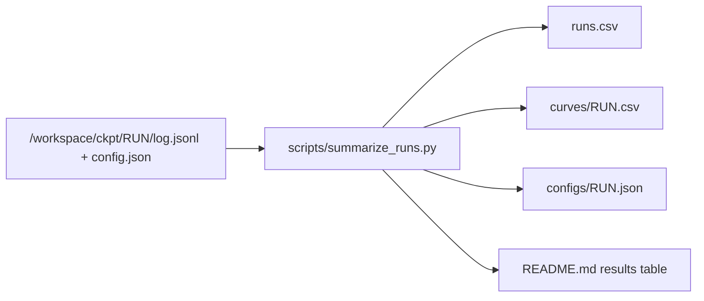

# Results

All files here are made by scripts from the run logs. Do not edit them by hand.
Rebuild them with `bash scripts/build_results.sh`. Run it after each training stage. Then commit `results/`.

Source files on the left. Files that go into git on the right.

## Files
| File | Content |
|---|---|
| `runs.csv` | One row per training run |
| `curves/RUN.csv` | Loss curve of one run. Every eval point and every 5th train line |
| `configs/RUN.json` | Settings of one run: seed, learning rate, git hash, torch version |
| `data/dataset.json` | Size of the shards: games and tokens per split, filter, vocabulary |
| `data/month_counts.csv` | Games and tokens in month 2026-09 at three rating limits |
| `EXPERIMENT_LOG.md` | Dated list of every step, with run names and results |

Later stages add `token_sweep.csv`, `eval/`, `probe/` and `figures/`. See `PLAN.md`, section Logging.

## Columns of `runs.csv`
| Column | Meaning |
|---|---|
| `run` | Run name. It is also the folder name in `/workspace/ckpt` |
| `stage` | `overfit`, `lr_sweep`, `speed`, `size_sweep` or `token_sweep`. The script reads it from the run name |
| `model` | `xs`, `s`, `m` or `l` |
| `params` | Number of parameters |
| `lr` | Peak learning rate |
| `seed` | Random seed. The seed sets the weight start and the data order |
| `max_tokens` | Planned length of the run |
| `tokens_done` | Tokens trained so far |
| `final_val_loss` | Loss per move on the validation split at the end. Empty while the run is running |
| `best_val_loss` | Lowest validation loss during the run |
| `median_tok_s` | Median training speed in tokens per second |
| `median_mfu` | Median share of the A100 peak speed (312 TFLOPs, bf16) |
| `status` | `done` or `running` |
| `git_hash` | Git commit when the run started. The code can have had uncommitted changes |
| `date` | Date the run started (UTC) |

## Notes
- Loss per move is the cross-entropy per token. One token is one move. A model that guesses at random gets about 7.6 (ln 1971).
- Short runs give rough numbers only. Differences below about 0.05 at 0.1B tokens are noise (seed-to-seed spread).
- Speed runs (`speed_*`) use 15M tokens. Their `median_tok_s` includes the compile time. Use the `size_*` runs for steady speed.
- Peak GPU memory is not in the logs. It is noted in `EXPERIMENT_LOG.md`.
