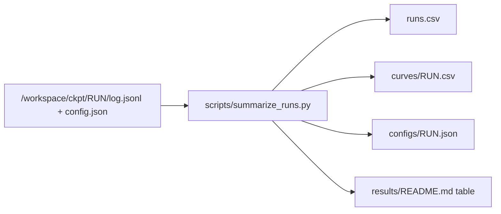

# Results

All files here are made by scripts from the run logs. Do not edit them by hand.
Rebuild them with `bash scripts/build_results.sh`. Run it after each training stage. Then commit `results/`.

Source files on the left. Files that go into git on the right.

## Files
| File | Content |
|---|---|
| `runs.csv` | One row per training run |
| `curves/RUN.csv` | Loss curve of one run. Every eval point and every 5th train line |
| `configs/RUN.json` | Settings of one run: seed, learning rate, git hash, torch version |
| `data/dataset.json` | Size of the shards: games and tokens per split, filter, vocabulary |
| `data/month_counts.csv` | Games and tokens in month 2026-09 at three rating limits |
| `EXPERIMENT_LOG.md` | Dated list of every step, with run names and results |
| `token_sweep.csv` | Val loss against total tokens seen, per model (G16-G18) |
| `rate_check.csv` | Val loss against total tokens seen, L at two rates (G20, G22) |
| `scaling_fit.csv` | Scaling law: exponents with 95% intervals, held-out errors, Elo against loss (G29) |
| `scaling_points.csv` | The 16 fitted runs and the 2 held-out runs, with the fitted loss (G29) |
| `eval/` | Legal-move rate, Stockfish games and Elo per model (G14, G19) |
| `probe/probe_by_layer.csv` | Probe scores per layer, target and probe type (G21, G23) |
| `probe/probe_by_ply.csv` | Probe scores by ply: best layer against the move-history control |
| `probe/controls.csv` | The 5 probe controls |
| `probe/intervention.csv` | Loss, legal-move rate and last-layer probe after removing probe or random directions |
| `probe/errors_by_piece.csv` | Probe and move-history recall and error kinds by piece class (G25) |
| `probe/ghosts.csv` | Ghost pieces on empty squares, by move history of the square (G25) |
| `probe/confusion.csv` | Confusion table of the layer-8 linear probe, 13 x 13 (G25) |

The probe files come from `python -m chesslm.probe.run` (needs the GPU) and `python -m chesslm.probe.errors` (CPU). `build_results.sh` does not rebuild them. Figures (`figures/*.png`) come from `python scripts/make_figures.py`, which reads only the CSV files here. See `PLAN.md`, section Logging.

## Columns of `runs.csv`
| Column | Meaning |
|---|---|
| `run` | Run name. It is also the folder name in `/workspace/ckpt` |
| `stage` | `overfit`, `lr_sweep`, `speed`, `size_sweep` or `token_sweep`. The script reads it from the run name |
| `model` | `xs`, `s`, `m` or `l` |
| `params` | Number of parameters |
| `lr` | Peak learning rate |
| `seed` | Random seed. The seed sets the weight start and the data order |
| `max_tokens` | Planned length of the run |
| `tokens_done` | Tokens trained so far |
| `final_val_loss` | Loss per move on the validation split at the end. Empty while the run is running |
| `best_val_loss` | Lowest validation loss during the run |
| `median_tok_s` | Median training speed in tokens per second |
| `median_mfu` | Median share of the A100 peak speed (312 TFLOPs, bf16) |
| `status` | `done` or `running` |
| `git_hash` | Git commit when the run started. The code can have had uncommitted changes |
| `date` | Date the run started (UTC) |

## Notes
- Loss per move is the cross-entropy per token. One token is one move. A model that guesses at random gets about 7.6 (ln 1971).
- Short runs give rough numbers only. Differences below about 0.05 at 0.1B tokens are noise (seed-to-seed spread).
- Speed runs (`speed_*`) use 15M tokens. Their `median_tok_s` includes the compile time. Use the `size_*` runs for steady speed.
- Peak GPU memory is not in the logs. It is noted in `EXPERIMENT_LOG.md`.

## All training runs
The table below comes from `runs.csv`. `bash scripts/build_results.sh` rebuilds it.

<!-- RESULTS:START -->
| Stage | Run | Model | Params | lr | Seed | Tokens | Val loss | Status |
|---|---|---|---|---|---|---|---|---|
| overfit | overfit_xs | xs | 5.2M | 0.0005 | 0 | 0.040B | 0.0939 | done |
| lr_sweep | lr_xs_1e-3 | xs | 5.2M | 0.001 | 0 | 0.100B | 2.4836 | done |
| lr_sweep | lr_xs_2e-3 | xs | 5.2M | 0.002 | 0 | 0.100B | 2.3197 | done |
| lr_sweep | lr_xs_2e-3_s1 | xs | 5.2M | 0.002 | 1 | 0.100B | 2.3432 | done |
| lr_sweep | lr_xs_3e-3 | xs | 5.2M | 0.003 | 0 | 0.100B | 2.3758 | done |
| lr_sweep | lr_xs_3e-3_s1 | xs | 5.2M | 0.003 | 1 | 0.100B | 2.3309 | done |
| lr_sweep | lr_xs_4.5e-3 | xs | 5.2M | 0.0045 | 0 | 0.100B | 2.3399 | done |
| lr_sweep | lr_xs_4.5e-3_s1 | xs | 5.2M | 0.0045 | 1 | 0.100B | 2.3121 | done |
| lr_sweep | lr_xs_6e-3 | xs | 5.2M | 0.006 | 0 | 0.100B | 2.3748 | done |
| lr_sweep | lr_xs_1e-2 | xs | 5.2M | 0.01 | 0 | 0.100B | 3.5064 | done |
| lr_sweep | lr_xs_1.5e-2 | xs | 5.2M | 0.015 | 0 | 0.100B | 3.5973 | done |
| lr_sweep | lr_l_1e-3 | l | 50.4M | 0.001 | 0 | 0.100B | 1.9594 | done |
| lr_sweep | lr_l_2e-3 | l | 50.4M | 0.002 | 0 | 0.100B | 1.945 | done |
| lr_sweep | lr_l_3e-3 | l | 50.4M | 0.003 | 0 | 0.100B | 3.3323 | done |
| speed | speed_s | s | 11.4M | 0.003 | 0 | 0.015B | 5.1307 | done |
| speed | speed_m | m | 26.2M | 0.003 | 0 | 0.015B | 4.9313 | done |
| speed | speed_l | l | 50.4M | 0.003 | 0 | 0.015B | 5.1861 | done |
| size_sweep | size_xs | xs | 5.2M | 0.003 | 0 | 1.000B | 1.789 | done |
| size_sweep | size_s | s | 11.4M | 0.002 | 0 | 1.000B | 1.6427 | done |
| size_sweep | size_m | m | 26.2M | 0.0015 | 0 | 1.000B | 1.5192 | done |
| size_sweep | size_l | l | 50.4M | 0.0012 | 0 | 1.000B | 1.4652 | done |
| seed_check | seed_xs_s1 | xs | 5.2M | 0.003 | 1 | 1.000B | 1.783 | done |
| seed_check | seed_s_s1 | s | 11.4M | 0.002 | 1 | 1.000B | 1.6379 | done |
| seed_check | seed_m_s1 | m | 26.2M | 0.0015 | 1 | 1.000B | 1.5173 | done |
| seed_check | seed_l_s1 | l | 50.4M | 0.0012 | 1 | 1.000B | 1.4622 | done |
| token_sweep | tok_xs_125m | xs | 5.2M | 0.003 | 0 | 0.156B | 2.1114 | done |
| token_sweep | tok_xs_250m | xs | 5.2M | 0.003 | 0 | 0.313B | 1.9488 | done |
| token_sweep | tok_xs_500m | xs | 5.2M | 0.003 | 0 | 0.625B | 1.8342 | done |
| token_sweep | tok_s_125m | s | 11.4M | 0.002 | 0 | 0.156B | 1.9947 | done |
| token_sweep | tok_s_250m | s | 11.4M | 0.002 | 0 | 0.313B | 1.8116 | done |
| token_sweep | tok_s_500m | s | 11.4M | 0.002 | 0 | 0.625B | 1.6942 | done |
| token_sweep | tok_m_125m | m | 26.2M | 0.0015 | 0 | 0.156B | 1.8609 | done |
| token_sweep | tok_m_250m | m | 26.2M | 0.0015 | 0 | 0.313B | 1.6824 | done |
| token_sweep | tok_m_500m | m | 26.2M | 0.0015 | 0 | 0.625B | 1.5681 | done |
| token_sweep | tok_l_125m | l | 50.4M | 0.0012 | 0 | 0.156B | 1.785 | done |
| token_sweep | tok_l_250m | l | 50.4M | 0.0012 | 0 | 0.313B | 1.6158 | done |
| token_sweep | tok_l_500m | l | 50.4M | 0.0012 | 0 | 0.625B | 1.5119 | done |
| rate_check | rate_l_6e-4 | l | 50.4M | 0.0006 | 0 | 1.000B | 1.4734 | done |
| rate_check | rate_l_6e-4_125m | l | 50.4M | 0.0006 | 0 | 0.156B | 1.8766 | done |
| rate_check | rate_l_6e-4_250m | l | 50.4M | 0.0006 | 0 | 0.313B | 1.6636 | done |
| rate_check | rate_l_6e-4_500m | l | 50.4M | 0.0006 | 0 | 0.625B | 1.5319 | done |
| other | full_m | m | 26.2M | 0.0015 | 0 | 1.600B | 1.4823 | done |
| other | full_l | l | 50.4M | 0.0012 | 0 | 1.600B | 1.431 | done |
<!-- RESULTS:END -->
